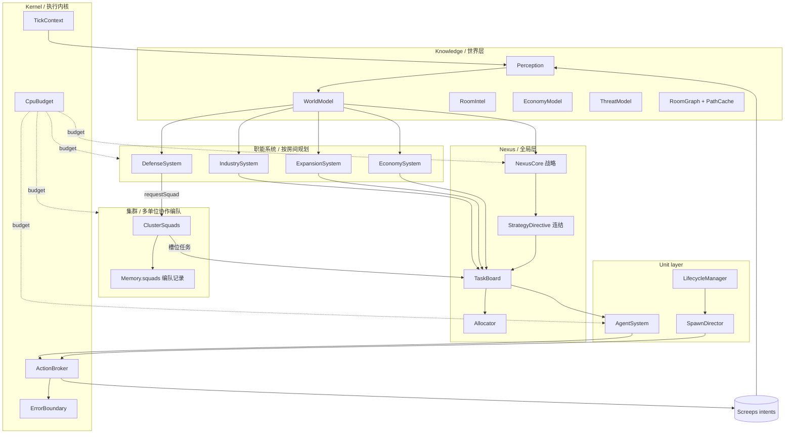

# 03. 总体架构、模块职责与 Tick 生命周期

> 落地对照：模块清单与执行序以 `src/modules/index.ts` 的 `createDefaultModules()` 为唯一权威；
> 阶段顺序以 `src/core/phases.ts` 的 `TICK_PHASES` 为唯一权威。本文描述职责与数据流，不复刻清单。
> 「智能连结集群」（多 Creep 协作编队）的完整架构见 docs/nexus-design/20；分层智能的落地契约见 docs/nexus-design/19。

## 3.1 逻辑架构

逻辑模块不是不同的游戏进程；它们都是同一份用户代码里的职责边界。
**集群层是唯一新增的横向协作层**：它不定义事务全流程（那是职能系统），只组织并维持多单位编队（见 docs/nexus-design/20 §20.1）。

## 3.2 模块职责与禁止事项

| 模块 | 应负责 | 不应负责 |
|---|---|---|
| `Kernel` | 初始化上下文、CPU 预算、错误隔离、阶段顺序 | 编码具体经济策略 |
| `Perception` | 收集可见房间对象、生成观测摘要 | 直接命令 Creep 行动 |
| `WorldModel` | 存取共享 Intel、构建派生视图 | 将未观测内容伪装成实时事实 |
| `NexusCore` | 制定战略姿态与全局目标 | 直接逐个控制所有 Creep |
| `StrategyDirective` | 把战略状态纯派生为单 Tick 指令视图 | 持久化状态；指挥单位 |
| `TaskBoard` | 任务创建、去重、租约、过期与状态转换 | 亲自执行 `harvest`/`build` |
| `Allocator` | 任务与机体匹配、负载平衡 | 每 Tick 无条件撤销现有任务 |
| `EconomySystem` / `DefenseSystem` | 房间内经济、防御计划；作为编队需求方 | 破坏其他系统已预留的关键资源；直接建队 |
| `ClusterSquads`（集群） | 编队生命周期（建队/续期/解散）与槽位任务维持 | 直接指挥成员；判断威胁；分配单位 |
| `SpawnDirector` | 生成需求、身体模板、生产排序 | 只凭角色数量忽略实际工作量 |
| `AgentSystem` | 把任务转成候选行动 | 越过统一执行层重复提交冲突命令 |
| `ActionBroker` | 校验、去重、优先级仲裁、记录返回码 | 将意图接受错误地视为最终效果已完成 |
| `Telemetry` | 产出指标、错误统计、可视化摘要 | 保存无限增长的日志历史 |

## 3.3 推荐 Tick 流程

每 Tick 按以下步骤执行，但允许将低优先级阶段跳过或缩减（阶段名以 `TICK_PHASES` 为准）：

1. **Bootstrap**：设置/迁移 Memory schema，建立本 Tick `TickContext`。
2. **Perception**：采集当前可见房间中的关键对象；避免无必要的重复 `find` 与全地图扫描。
3. **World Update**：更新观察时间、资源与威胁摘要、死亡单位和失效目标；清理过期状态。
4. **Emergency Response**（`emergency` 阶段）：威胁观测（`updateRoomThreat`）→ 应急任务（`planDefenseRoom`）→ 塔行动 → 塔能耗折叠；防御在此**登记编队需求**而非直接建队。
5. **Strategic Planning**（`strategy` 阶段）：若到达规划周期或发生重大事件，重新评估发展、扩张、防御和能源政策。
6. **Cluster Planning**（`planning` 阶段）：各房间生成所需任务，提交资源需求和局部约束；**编队模块消费需求、维持槽位任务**。
7. **Task Reconciliation**（`reconcile` 阶段）：去重、更新租约、释放失效任务、回收孤儿任务。
8. **Allocation**（同 `reconcile` 阶段）：为未分配任务选择合适 Creep；保留稳定任务，避免无意义重分配。
9. **Spawn Planning**（`spawn` 阶段）：补足关键能力缺口（含编队槽位任务缺口），比较能源预算与 Spawn 队列。
10. **Agent Execution**（`agents` 阶段）：每只 Creep 针对自己的任务提出计划。
11. **Action Broker**（`commit` 阶段）：校验目标、所有权、距离、身体部件与同类行动冲突，提交行动。
12. **Telemetry**：记录轻量级指标，输出必要的 RoomVisual/日志，并安排低频工作。

紧急防御可以在计划阶段之前先生成意图（`emergency` 阶段即位于战略之前）；但执行意图的入口仍然统一。

**与 EX MACHINA 蓝图十步流水线的对齐** (docs/nexus-design/23 §6.1):
现行 8 阶段是蓝图顺序的压缩实现——蓝图的 Reconcile 前置 (核验上 tick 结果先于规划) 与
Critical Commit 先行 (紧急动作先于普通执行) 是两条演进参照: 前者已部分体现 (perception 的
死亡单位发现 + reconcile 的失效回收), 后者由 `emergency` 阶段 + broker 的优先级仲裁承担。
后续若引入"关键提交锁" (普通仲裁不得覆盖紧急已锁定提交), 按 §6.1 第 5/8 步拆分实现。

**行动四状态契约** (docs/nexus-design/23 §3.1): Proposed (模块 submit) → Accepted (broker 仲裁通过)
→ Submitted (原生 API 受理, 返回码仅代表受理) → Observed (下一 tick 快照确认)。
`OK ≠ 世界已改变`: 任务完成一律以观察或可靠终止条件判定, 不以 API 返回码推断。

## 3.4 TickContext

所有需要共享本 Tick 数据的模块接收一个上下文对象，而不是重复访问全局单例并重新扫描世界。

建议上下文持有：

- 当前 `Game.time` 与 CPU 剩余估计；
- 已完成感知的可见房间列表和预聚合对象；
- Memory 的类型安全访问器；
- 本 Tick 产生的 Action Plan 集合；
- 只在当前 Tick 有效的 ID/对象缓存；
- CPU 预算状态及本 Tick 的性能计数。

任何 API 对象都只在当前 Tick 使用，不存入跨 Tick 持久化记忆。

## 3.5 数据流与依赖方向

推荐依赖方向：

`Game snapshot → Perception → WorldModel → Planner → TaskBoard → Agent Plan → ActionBroker → Intent → 下一 Tick 观测`。

反方向只通过观测和 Telemetry 反馈，而不让 `Agent` 直接修改战略状态。这样可避免模块之间形成循环依赖。

## 3.6 事件模型与定期轮询

重要事件可以触发快速重算：敌人出现、关键结构损坏、任务失效、Spawn 空闲、资源储备穿越阈值。但不要建立庞大的事件总线来模拟真实异步系统；Screeps 代码在 Tick 内是顺序执行的，事件通常可以表示为本 Tick 汇总的事实。

适合低频周期处理的事情：全局房间评分、市场价格统计、长路径重算、Memory 压缩、历史指标归纳。周期应可配置，并且每项任务都要有最大 CPU 成本和跳过条件。

## 3.7 错误隔离

错误分三类：

- **数据错误**：字段缺失、schema 太旧、目标 ID 查不到。局部修复或丢弃记录。
- **策略错误**：任务长期失败、运输超时、扩张回报不符预期。记录指标并进入重新规划。
- **程序错误**：意外异常。由模块边界捕获并以限频方式报告，保持其他关键模块继续运行。

不要用一个包围整段主循环、吞掉所有错误的空 `catch`。日志必须包含模块名、Tick、房间、任务 ID 和错误类别，但不应该无限打印相同错误。

