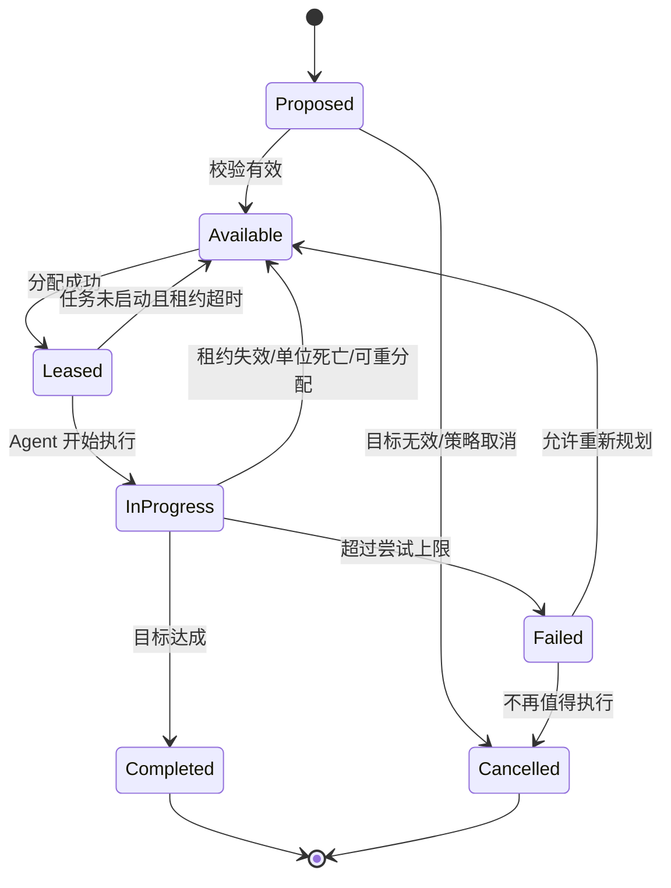

# 05. 任务黑板、调度器与能力匹配

> ⚠ Task 契约权威改向：任务/租约接口契约与失败语义已由 `docs/Nexus-Bot-01-架构设计.md` §10–§14 承载；TaskIndex 与迁移门禁见 02 篇 §7。本篇保留调度器与能力匹配的专题设计。冲突时以 01/02 篇为准。

## 5.1 为什么需要 Task Board

如果每个 Creep 直接根据局部情况选择工作，很容易出现所有单位同时采同一个 Source、某处堆满能源却没人搬运、建设与升级互相争抢劳动力、房间失去视野后任务无法恢复等情况。

Task Board 是所有 Cluster 与 Agent 共用的任务事实来源。它不直接执行动作，而是把“需要完成什么”从“由谁完成”中分离。

## 5.2 任务生命周期

任务状态不是写在某个 Creep 的内存里，而是存在共享任务记录中。Creep 的 `taskId` 只是指向它当前持有的任务租约。

## 5.3 任务类型与字段

建议任务至少包含：

- **身份**：`id`、`kind`、`roomName`、目标 ID/位置。
- **目标约束**：需要的能力、资源类别/数量、工作位置、允许房间、风险上限。
- **调度字段**：基础优先级、紧急度、创建 Tick、截止 Tick、尝试次数。
- **租约字段**：`assignedTo`、`leaseUntil`、最近进展 Tick。
- **结果**：已完成数量、失败原因、最近错误 Tick。
- **去重键**：例如 `harvest:room:sourceId`、`repair:room:structureId`，防止每 Tick 创建重复任务。

任务类型可以是 `harvest`、`haul`、`fill_spawn`、`upgrade`、`build`、`repair`、`scout`、`reserve`、`claim`、`defend`、`attack`、`heal`、`boost`、`terminal_transfer`、`factory_produce` 等。不要用字符串散落在各处；集中注册、校验和定义所需能力。

## 5.4 任务不只是“优先级数字”

基础优先级无法表达资源紧缺、截止时间和实际收益。推荐把优先级拆成：

- `criticality`：不做的后果，如 Spawn 断能、Controller 降级、关键目标被摧毁。
- `urgency`：距截止时间的风险。
- `utility`：预期产生的经济/战略收益。
- `capabilityFit`：候选 Creep 与任务需求的匹配程度。
- `travelCost`：路程及预期等待。
- `riskCost`：危险和可能损失。
- `switchCost`：放弃旧任务与新任务重定位成本。

评分函数示例：

`score(creep, task) = wC*C + wU*U + wV*V + wF*F - wD*D - wR*R - wS*S`

权重应按任务类别分开配置，并使用硬规则确保真正危急的任务不会被普通高收益任务压过。评分结果不是所有问题的替代品：Spawn 不能执行无身体能力的任务，目标容量已满时也不能因评分高而指派。

## 5.5 分配策略

建议先实现可解释的两阶段分配：

1. **筛选可行组合**：Creep 是否存活、是否正在 Spawn、是否拥有所需部件、能否进入目标房间、是否有合适容量、剩余寿命是否足够、当前是否被锁定于不可中断工作。
2. **排序分配**：先处理紧急任务，再以边际成本和任务收益选择单位；同分时优先选择距离近、切换成本低、已有路线可复用的单位。

初版可以使用贪心匹配；若以后任务规模、容量约束和竞争足够复杂，再考虑二分图最大权匹配或最小费用流。不要在几十只 Creep 的规模下先引入昂贵的优化器，却没有实际指标证明它有帮助。

## 5.6 租约与进展检测

- 任务分配写入 `assignedTo` 与 `leaseUntil`。
- Agent 周期更新 `lastProgressTick`，但不应在没有实质进展时无限刷新。
- 若目标不存在、房间无法到达、任务被抢先完成、机体死亡、关键资源缺失，立刻释放或取消。
- 若任务超过设定时间无进展，先分析是路径受阻、配额已满、资源缺失还是策略本身不合理，再选择重试、换位置或放弃。
- 任务重新分配时必须清除旧 Agent 指针，避免两个单位误以为自己拥有相同租约。

## 5.7 防止任务抖动

任务调度最常见的失败是每 Tick 都认为另一项任务稍微更好，导致单位不断切换但没有完成任何目标。解决办法：

- 设置最短持有时间或切换冷却，但紧急事件可以抢占；
- 加入 `switchCost`；
- 对短暂目标消失提供宽限期；
- 只在重要观测或状态越过阈值时重规划；
- 用 `completedPer100Ticks`、任务完成率和平均切换次数衡量是否过度调度。

## 5.8 Task Board 的最低接口

- `propose(task)`：按去重键创建或更新任务。
- `reconcile(world, now)`：清理失效任务、发现孤儿租约、更新状态。
- `lease(taskId, unitId, until)`：校验后分配。
- `release(taskId, reason)`：释放任务并记录原因。
- `complete(taskId, result)`：提交完成结果。
- `getCandidates(filter)`：只返回符合当前上下文的可用任务。
- `collectMetrics()`：输出完成率、超时、重试与取消统计。

## 5.9 承诺、行动状态与不变量 (对齐 docs/nexus-design/23 §3.1/§9/§12.4)

**四类承诺**——任务系统同时维护四种稀缺资源的排他性, 共享任务 ID 与有效期, 但不强行统一求解器:

| 承诺 | 含义 | 本项目落点 |
|---|---|---|
| 单位承诺 | 同一时间窗内同一单位不能被两个任务独占 | 租约 (`assignedTo`/`leaseUntil`) |
| 资源承诺 | 同一存量不能被重复计入可支配资源 | 账本 (`economy/ledger` reserve/commit/release) |
| 产能承诺 | spawn/lab/terminal 等结构能力不能超额预约 | spawn 排程 + 替补窗口 (工业阶段扩展) |
| 空间承诺 | 期望位置、工作站与关键通道有冲突规则 | worksite 驻点 + traffic 热点让路 |

**行动四状态**: Proposed (模块 submit) → Accepted (broker 仲裁) → Submitted (API 受理)
→ Observed (下一 tick 快照确认)。提交成功不等于任务完成——`complete()` 必须由观察或可靠终止条件触发。

**任务侧核心不变量** (完整十条见 docs/nexus-design/23 §12.4):
1. 每个单位最多一个生效的独占租约;
2. 同一 actor 同一方法每 tick 最多提交一次;
3. 正常阶段不得覆盖紧急阶段已锁定的提交;
4. 提交成功 ≠ 任务完成;
5. 可用资源不能同时被多个任务无约束消费;
6. 所有等待状态都有超时或外部解除条件。
