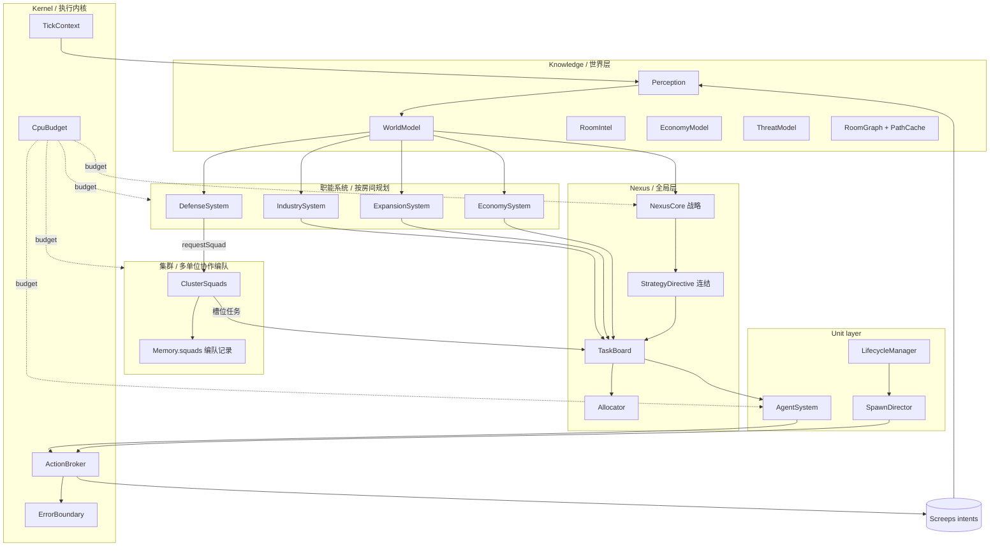
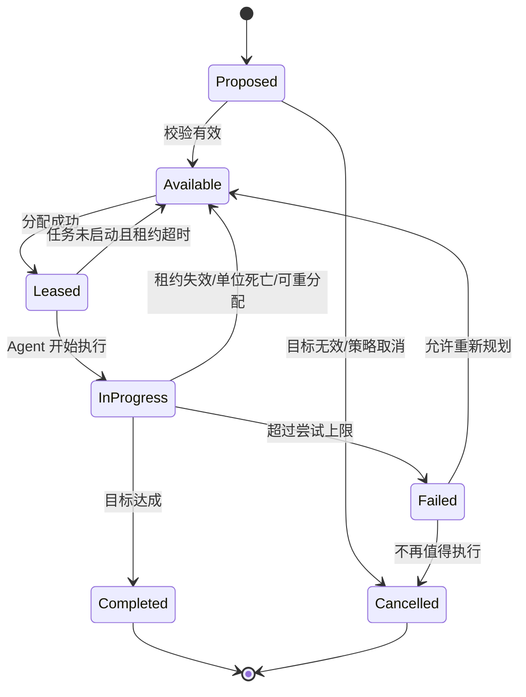
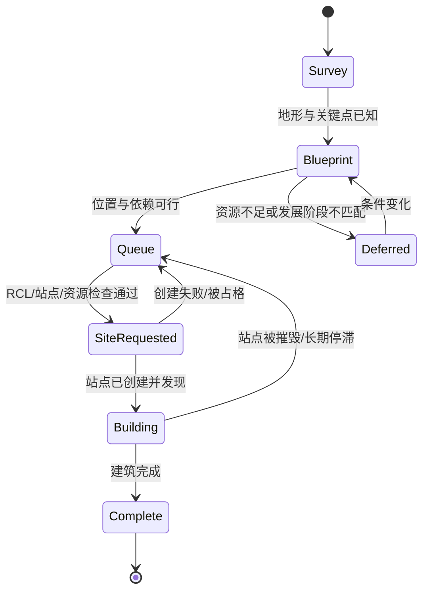

# 历史设计存档（原 03–17 篇）

> 本文件合并了 01–18 系列中已被 `docs/Nexus-Bot-01` / `02` 取代的 12 篇设计稿，**不得作为实现依据**。
> 各节沿用原篇号（3–17），编号不连续属正常；引用写作 `09-legacy-archive.md §17.3`。
> 现行权威见各节开头的「权威改向」标注；裁定规则见 `docs/Nexus-Bot-架构设计与重构指导.md` §2。

---

## 3. 总体架构、模块职责与 Tick 生命周期

> 落地对照：模块装配清单以 `src/main.ts` 的 `nexus.use(...)` 为唯一权威（平铺挂载，目录规范见 `02-architecture-charter.md` §21.1）；
> 阶段顺序以 `src/core/phases.ts` 的 `TICK_PHASES` 为唯一权威。本文描述职责与数据流，不复刻清单。
> 「智能连结集群」（多 Creep 协作编队）的完整架构见 docs/nexus-design/20；分层智能的落地契约见 docs/nexus-design/02-architecture-charter.md §19。

> ⚠ 架构权威源改向：目标架构总图、六层职责与层间接口契约已由 `docs/Nexus-Bot-01-架构设计.md` §3–§4、§14 承载（本篇保留 Tick 生命周期与数据流的演进描述）。冲突时以 01 篇为准。

### 3.1 逻辑架构



逻辑模块不是不同的游戏进程；它们都是同一份用户代码里的职责边界。
**集群层是唯一新增的横向协作层**：它不定义事务全流程（那是职能系统），只组织并维持多单位编队（见 docs/nexus-design/20 §20.1）。

### 3.2 模块职责与禁止事项

| 模块 | 应负责 | 不应负责 |
|---|---|---|
| `Kernel` | 初始化上下文、CPU 预算、错误隔离、阶段顺序 | 编码具体经济策略 |
| `Perception` | 收集可见房间对象、生成观测摘要 | 直接命令 Creep 行动 |
| `WorldModel` | 存取共享 Intel、构建派生视图 | 将未观测内容伪装成实时事实 |
| `NexusCore` | 制定战略姿态与全局目标 | 直接逐个控制所有 Creep |
| `StrategyDirective` | 把战略状态纯派生为单 Tick 指令视图 | 持久化状态；指挥单位 |
| `TaskBoard` | 任务创建、去重、租约、过期与状态转换 | 亲自执行 `harvest`/`build` |
| `Allocator` | 任务与机体匹配、负载平衡 | 每 Tick 无条件撤销现有任务 |
| `EconomySystem` / `DefenseSystem` | 房间内经济、防御计划；作为编队需求方 | 破坏其他系统已预留的关键资源；直接建队 |
| `ClusterSquads`（集群） | 编队生命周期（建队/续期/解散）与槽位任务维持 | 直接指挥成员；判断威胁；分配单位 |
| `SpawnDirector` | 生成需求、身体模板、生产排序 | 只凭角色数量忽略实际工作量 |
| `AgentSystem` | 把任务转成候选行动 | 越过统一执行层重复提交冲突命令 |
| `ActionBroker` | 校验、去重、优先级仲裁、记录返回码 | 将意图接受错误地视为最终效果已完成 |
| `Telemetry` | 产出指标、错误统计、可视化摘要 | 保存无限增长的日志历史 |

### 3.3 推荐 Tick 流程

每 Tick 按以下步骤执行，但允许将低优先级阶段跳过或缩减（阶段名以 `TICK_PHASES` 为准）：

1. **Bootstrap**：设置/迁移 Memory schema，建立本 Tick `TickContext`。
2. **Perception**：采集当前可见房间中的关键对象；避免无必要的重复 `find` 与全地图扫描。
3. **World Update**：更新观察时间、资源与威胁摘要、死亡单位和失效目标；清理过期状态。
4. **Emergency Response**（`emergency` 阶段）：威胁观测（`updateRoomThreat`）→ 应急任务（`planDefenseRoom`）→ 塔行动 → 塔能耗折叠；防御在此**登记编队需求**而非直接建队。
5. **Strategic Planning**（`strategy` 阶段）：若到达规划周期或发生重大事件，重新评估发展、扩张、防御和能源政策。
6. **Cluster Planning**（`planning` 阶段）：各房间生成所需任务，提交资源需求和局部约束；**编队模块消费需求、维持槽位任务**。
7. **Task Reconciliation**（`reconcile` 阶段）：去重、更新租约、释放失效任务、回收孤儿任务。
8. **Allocation**（同 `reconcile` 阶段）：为未分配任务选择合适 Creep；保留稳定任务，避免无意义重分配。
9. **Spawn Planning**（`spawn` 阶段）：补足关键能力缺口（含编队槽位任务缺口），比较能源预算与 Spawn 队列。
10. **Agent Execution**（`agents` 阶段）：每只 Creep 针对自己的任务提出计划。
11. **Action Broker**（`commit` 阶段）：校验目标、所有权、距离、身体部件与同类行动冲突，提交行动。
12. **Telemetry**：记录轻量级指标，输出必要的 RoomVisual/日志，并安排低频工作。

紧急防御可以在计划阶段之前先生成意图（`emergency` 阶段即位于战略之前）；但执行意图的入口仍然统一。

**与 EX MACHINA 蓝图十步流水线的对齐** (docs/nexus-design/23 §6.1):
现行 8 阶段是蓝图顺序的压缩实现——蓝图的 Reconcile 前置 (核验上 tick 结果先于规划) 与
Critical Commit 先行 (紧急动作先于普通执行) 是两条演进参照: 前者已部分体现 (perception 的
死亡单位发现 + reconcile 的失效回收), 后者由 `emergency` 阶段 + broker 的优先级仲裁承担。
后续若引入"关键提交锁" (普通仲裁不得覆盖紧急已锁定提交), 按 §6.1 第 5/8 步拆分实现。

**行动四状态契约** (docs/nexus-design/23 §3.1): Proposed (模块 submit) → Accepted (broker 仲裁通过)
→ Submitted (原生 API 受理, 返回码仅代表受理) → Observed (下一 tick 快照确认)。
`OK ≠ 世界已改变`: 任务完成一律以观察或可靠终止条件判定, 不以 API 返回码推断。

### 3.4 TickContext

所有需要共享本 Tick 数据的模块接收一个上下文对象，而不是重复访问全局单例并重新扫描世界。

建议上下文持有：

- 当前 `Game.time` 与 CPU 剩余估计；
- 已完成感知的可见房间列表和预聚合对象；
- Memory 的类型安全访问器；
- 本 Tick 产生的 Action Plan 集合；
- 只在当前 Tick 有效的 ID/对象缓存；
- CPU 预算状态及本 Tick 的性能计数。

任何 API 对象都只在当前 Tick 使用，不存入跨 Tick 持久化记忆。

### 3.5 数据流与依赖方向

推荐依赖方向：

`Game snapshot → Perception → WorldModel → Planner → TaskBoard → Agent Plan → ActionBroker → Intent → 下一 Tick 观测`。

反方向只通过观测和 Telemetry 反馈，而不让 `Agent` 直接修改战略状态。这样可避免模块之间形成循环依赖。

### 3.6 事件模型与定期轮询

重要事件可以触发快速重算：敌人出现、关键结构损坏、任务失效、Spawn 空闲、资源储备穿越阈值。但不要建立庞大的事件总线来模拟真实异步系统；Screeps 代码在 Tick 内是顺序执行的，事件通常可以表示为本 Tick 汇总的事实。

适合低频周期处理的事情：全局房间评分、市场价格统计、长路径重算、Memory 压缩、历史指标归纳。周期应可配置，并且每项任务都要有最大 CPU 成本和跳过条件。

### 3.7 错误隔离

错误分三类：

- **数据错误**：字段缺失、schema 太旧、目标 ID 查不到。局部修复或丢弃记录。
- **策略错误**：任务长期失败、运输超时、扩张回报不符预期。记录指标并进入重新规划。
- **程序错误**：意外异常。由模块边界捕获并以限频方式报告，保持其他关键模块继续运行。

不要用一个包围整段主循环、吞掉所有错误的空 `catch`。日志必须包含模块名、Tick、房间、任务 ID 和错误类别，但不应该无限打印相同错误。

---

## 4. 世界模型、Intel 与持久化记忆

> ⚠ Memory 分层权威改向：Memory schema 字段表模板、NexusMemory 顶层结构与 Memory/Runtime 分界线已由 `docs/Nexus-Bot-01-架构设计.md` §24 承载（本篇保留 intel 与记忆分层的演进描述）。冲突时以 01 篇为准。

### 4.1 记忆分层

建议分四层管理数据：

1. **Live Snapshot**：`Game` 中本 Tick 可见的对象；只读临时使用。
2. **Tick Cache**：本 Tick 内可重用的对象列表、距离、能力画像等；Tick 结束即可丢弃。
3. **Persistent Memory**：需要跨 Tick 保留的任务、战略、房间 Intel、单位状态和资源承诺。
4. **Segmented/Arcnexus Data**：只有在确实需要保存大规模长周期数据时使用 RawMemory segments；低频读写并设置数据格式版本。

切勿将 live object（例如 `Creep`、`Room`、`Structure`）直接写入 Memory。保存对象 ID，使用时通过 API 重新获取，并容忍 ID 失效。

### 4.2 推荐 schema

这是概念 schema，实际接口可以按工程拆分。所有持久化结构都应保留 `schemaVersion`，并由统一迁移逻辑升级。

```ts
interface NexusMemoryV1 {
  schemaVersion: number;
  global: {
    posture: "survive" | "develop" | "expand" | "war";
    lastStrategicTick: number;
    goals: Record<string, number>;
    policy: {
      minEnergyReserve: number;
      expansionRiskTolerance: number;
    };
  };
  rooms: Record<string, RoomIntel>;
  tasks: Record<string, NexusTask>;
  units: Record<string, UnitRecord>;
  economy: {
    reservations: Record<string, ResourceReservation>;
    commitments: Record<string, number>;
  };
  routes: Record<string, RouteRecord>;
  metrics: MetricsSummary;
}

interface RoomIntel {
  lastSeen: number;
  confidence: number;          // 0..1; does not mean the room is currently visible
  owner?: string;
  reservation?: { owner: string; untilTick: number };
  rcl?: number;
  sourceIds: string[];
  mineralType?: string;
  threatScore: number;
  threatLastSeen?: number;
  exits: string[];
  estimatedRouteCost?: number;
}

interface UnitRecord {
  schemaVersion: number;
  homeRoom?: string;
  taskId?: string;
  bornAt: number;
  lastTaskChange: number;
  lastProgressTick?: number;
  blockedCount?: number;
  roleHint?: string;           // optional hint, never the source of capability truth
}
```

不要每 Tick 把所有 `Game.rooms` 重新序列化进 Memory。持久化 Intel 要按观察变化增量更新。

### 4.3 Intel 的新鲜度

对于每条可变化情报，记录 `lastSeen`，必要时带 `confidence` 和 `source`。

推荐策略示例（需按实际玩法调参）：

- 敌方 Creep 坐标：只视为当次观察结果；超过一个 Tick 就不再叫“实时坐标”。
- 房间 owner/reservation/RCL：可在一段时间内作战略估计，但要随着未观测时间增长降低置信度。
- 道路与建筑布局：被观测一次后相对稳定，但战争可能改变道路或建筑状态；路线缓存仍需要失效条件。
- Source 和 Mineral ID：只有当房间曾经可见且目标 ID 重新确认有效时才能使用；通过 API 找不到时要重新侦察。

“未知”“已知为空”“已知存在但过期”应是三个不同状态。

### 4.4 Memory schema 迁移

迁移流程：

1. 检查 `Memory.nexus` 是否存在。
2. 缺失时初始化当前 schema 的最小有效结构。
3. 低版本时逐版本迁移，不要直接把任意旧对象当作新类型。
4. 迁移失败时备份关键战略值（若可控），清理受影响的子系统并记录告警。
5. 迁移完成写入当前版本，避免每 Tick 重复迁移。

建议每个版本单独编写 `migrateV1ToV2` 等纯函数，并对样例 Memory 做单元测试。

### 4.5 Memory 膨胀与垃圾回收

需要维护的清理规则：

- 删除长时间没有对应 Creep 的 `units` 条目；但先检查这只单位的任务是否需要重新分配。
- 删除完成且超过保留期的任务；为排错只保留统计摘要，不保留无限事件记录。
- 丢弃过期 Route Cache 与低置信度 Intel；重要的敌对历史可保存聚合统计。
- 对历史指标只保留最近窗口、均值、分位数和计数等压缩值。
- 定期统计 JSON 序列化大小，并设置警戒阈值，不能等到 Memory 写入失败才处理。

官方文档说明主 Memory 容量有限（目前说明为 2 MB）。RawMemory segments 可作为扩展，但每段与激活规则也有限制，所以应以精简数据为第一原则。

### 4.6 跨 Shard 数据

若使用 InterShardMemory/Shard 相关 API，应把跨 Shard 消息作为独立子系统设计：

- 传输紧凑摘要，而非复制完整 Memory；
- 每条消息包含 schema、来源 Shard、发送 Tick、过期 Tick 与去重 ID；
- 无法读取或数据不可信时降级到本地战略，不阻塞主循环；
- 不能假设门户永远存在或所有 Shard 永远可访问。

这部分只有在目标玩法确实需要跨 Shard 时再实现。单 Shard 起步不应该为其付出常态 CPU 与维护成本。

### 4.7 WorldModel 接口建议

`WorldModel` 应向策略模块提供查询方法，而不是暴露底层 Memory 原始对象：

- `getRoomIntel(roomName)`：获取 Intel 及新鲜度状态。
- `getVisibleRoomSummary(room)`：将当前可见对象聚合为成本可控的摘要。
- `getThreat(roomName)`：当前可见威胁与历史风险分开返回。
- `getRoomCapabilities(roomName)`：按可见 RCL、建筑和权限判断能力。
- `markObserved(...)`：由 Perception 更新当前事实。
- `expire(now)`：低频清除过期缓存。

---

## 5. 任务黑板、调度器与能力匹配

> ⚠ Task 契约权威改向：任务/租约接口契约与失败语义已由 `docs/Nexus-Bot-01-架构设计.md` §10–§14 承载；TaskIndex 与迁移门禁见 02 篇 §7。本篇保留调度器与能力匹配的专题设计。冲突时以 01/02 篇为准。

### 5.1 为什么需要 Task Board

如果每个 Creep 直接根据局部情况选择工作，很容易出现所有单位同时采同一个 Source、某处堆满能源却没人搬运、建设与升级互相争抢劳动力、房间失去视野后任务无法恢复等情况。

Task Board 是所有 Cluster 与 Agent 共用的任务事实来源。它不直接执行动作，而是把“需要完成什么”从“由谁完成”中分离。

### 5.2 任务生命周期



任务状态不是写在某个 Creep 的内存里，而是存在共享任务记录中。Creep 的 `taskId` 只是指向它当前持有的任务租约。

### 5.3 任务类型与字段

建议任务至少包含：

- **身份**：`id`、`kind`、`roomName`、目标 ID/位置。
- **目标约束**：需要的能力、资源类别/数量、工作位置、允许房间、风险上限。
- **调度字段**：基础优先级、紧急度、创建 Tick、截止 Tick、尝试次数。
- **租约字段**：`assignedTo`、`leaseUntil`、最近进展 Tick。
- **结果**：已完成数量、失败原因、最近错误 Tick。
- **去重键**：例如 `harvest:room:sourceId`、`repair:room:structureId`，防止每 Tick 创建重复任务。

任务类型可以是 `harvest`、`carry`、`fill_spawn`、`upgrade`、`build`、`repair`、`scout`、`reserve`、`claim`、`defend`、`attack`、`heal`、`boost`、`terminal_transfer`、`factory_produce` 等。不要用字符串散落在各处；集中注册、校验和定义所需能力。

### 5.4 任务不只是“优先级数字”

基础优先级无法表达资源紧缺、截止时间和实际收益。推荐把优先级拆成：

- `criticality`：不做的后果，如 Spawn 断能、Controller 降级、关键目标被摧毁。
- `urgency`：距截止时间的风险。
- `utility`：预期产生的经济/战略收益。
- `capabilityFit`：候选 Creep 与任务需求的匹配程度。
- `travelCost`：路程及预期等待。
- `riskCost`：危险和可能损失。
- `switchCost`：放弃旧任务与新任务重定位成本。

评分函数示例：

`score(creep, task) = wC*C + wU*U + wV*V + wF*F - wD*D - wR*R - wS*S`

权重应按任务类别分开配置，并使用硬规则确保真正危急的任务不会被普通高收益任务压过。评分结果不是所有问题的替代品：Spawn 不能执行无身体能力的任务，目标容量已满时也不能因评分高而指派。

### 5.5 分配策略

建议先实现可解释的两阶段分配：

1. **筛选可行组合**：Creep 是否存活、是否正在 Spawn、是否拥有所需部件、能否进入目标房间、是否有合适容量、剩余寿命是否足够、当前是否被锁定于不可中断工作。
2. **排序分配**：先处理紧急任务，再以边际成本和任务收益选择单位；同分时优先选择距离近、切换成本低、已有路线可复用的单位。

初版可以使用贪心匹配；若以后任务规模、容量约束和竞争足够复杂，再考虑二分图最大权匹配或最小费用流。不要在几十只 Creep 的规模下先引入昂贵的优化器，却没有实际指标证明它有帮助。

### 5.6 租约与进展检测

- 任务分配写入 `assignedTo` 与 `leaseUntil`。
- Agent 周期更新 `lastProgressTick`，但不应在没有实质进展时无限刷新。
- 若目标不存在、房间无法到达、任务被抢先完成、机体死亡、关键资源缺失，立刻释放或取消。
- 若任务超过设定时间无进展，先分析是路径受阻、配额已满、资源缺失还是策略本身不合理，再选择重试、换位置或放弃。
- 任务重新分配时必须清除旧 Agent 指针，避免两个单位误以为自己拥有相同租约。

### 5.7 防止任务抖动

任务调度最常见的失败是每 Tick 都认为另一项任务稍微更好，导致单位不断切换但没有完成任何目标。解决办法：

- 设置最短持有时间或切换冷却，但紧急事件可以抢占；
- 加入 `switchCost`；
- 对短暂目标消失提供宽限期；
- 只在重要观测或状态越过阈值时重规划；
- 用 `completedPer100Ticks`、任务完成率和平均切换次数衡量是否过度调度。

### 5.8 Task Board 的最低接口

- `propose(task)`：按去重键创建或更新任务。
- `reconcile(world, now)`：清理失效任务、发现孤儿租约、更新状态。
- `lease(taskId, unitId, until)`：校验后分配。
- `release(taskId, reason)`：释放任务并记录原因。
- `complete(taskId, result)`：提交完成结果。
- `getCandidates(filter)`：只返回符合当前上下文的可用任务。
- `collectMetrics()`：输出完成率、超时、重试与取消统计。


### 5.9 承诺、行动状态与不变量 (对齐 docs/nexus-design/23 §3.1/§9/§12.4)

**四类承诺**——任务系统同时维护四种稀缺资源的排他性, 共享任务 ID 与有效期, 但不强行统一求解器:

| 承诺 | 含义 | 本项目落点 |
|---|---|---|
| 单位承诺 | 同一时间窗内同一单位不能被两个任务独占 | 租约 (`assignedTo`/`leaseUntil`) |
| 资源承诺 | 同一存量不能被重复计入可支配资源 | 账本 (`economy/ledger` reserve/commit/release) |
| 产能承诺 | spawn/lab/terminal 等结构能力不能超额预约 | spawn 排程 + 替补窗口 (工业阶段扩展) |
| 空间承诺 | 期望位置、工作站与关键通道有冲突规则 | worksite 驻点 + traffic 热点让路 |

**行动四状态**: Proposed (模块 submit) → Accepted (broker 仲裁) → Submitted (API 受理)
→ Observed (下一 tick 快照确认)。提交成功不等于任务完成——`complete()` 必须由观察或可靠终止条件触发。

**任务侧核心不变量** (完整十条见 docs/nexus-design/23 §12.4):
1. 每个单位最多一个生效的独占租约;
2. 同一 actor 同一方法每 tick 最多提交一次;
3. 正常阶段不得覆盖紧急阶段已锁定的提交;
4. 提交成功 ≠ 任务完成;
5. 可用资源不能同时被多个任务无约束消费;
6. 所有等待状态都有超时或外部解除条件。

---

## 6. 经济模型、运输网络与资源账本

> ⚠ 账本权威改向：ResourceLedger 五态分账的字段级 schema、记账时点与不变量已由 `docs/Nexus-Bot-01-架构设计.md` §18.1 承载。本篇保留运输网络与资源流专题设计。冲突时以 01 篇为准。

### 6.1 不只是采集产量：资源流

经济模型应把每个房间视为资源生产、转运、储存和消费节点构成的网络。一个殖民地可以因为能源总量不足而失败，也可以因为能源在错误的位置、运输吞吐量不足、Spawn/Extension 缺货或不合理地投入升级而停滞。

建议每种资源跟踪：

- **库存**：当前可见结构与 Creep 携带的数量估算；
- **可用库存**：扣除已经预留给确定计划的数量；
- **生产速率**：以滚动窗口估计，不将单 Tick 瞬时值当作稳定产能；
- **消费速率**：Spawn、升级、建设、塔、工业与贸易消耗；
- **交付速率**：物流系统每 Tick 实际送达量；
- **运输成本**：距离、空载往返、道路情况、风险与拥堵；
- **库存目标**：关键建筑最低保障量、房间储备量与贸易储备量。

### 6.2 能源优先级政策

建议设置可调的最低储备线与政策：

1. 保证 Spawn/Extension 能持续满足必要生产。
2. 维持基本采集、维修和防御能力。
3. 支持 Controller 升级与必要建设。
4. 当净收入、库存和防御风险允许时，才投入远程采集、扩张、Boost 与市场套利。

储备线不能永久使用固定数值。它应考虑房间数量、最近生产队列、战斗风险、塔补给压力、路线补给时间和远程单位替换成本。

### 6.3 Source/矿工任务

- 按 Source ID 建立稳定的采集任务与工作点；多单位同时涌向一个 Source 会造成占位冲突。
- 对驻点矿工，计算采集吞吐与容器容量，并为离开/死亡情况保留替补策略。
- 若房间能源节点已被预留或目标不可达，则不应继续创建重复采集任务。
- 采集点和物流角色分离通常可以提高效率：矿工尽可能稳定生产，运输单位根据下游需求取货。
- 在早期，采集者兼任运输可能更简单；随着距离与单位数量增加，再明确分离职责。架构应支持两种模式。

### 6.4 搬运与批次设计

搬运任务应从“把能量送到某个对象”变成可计算的资源流：

- 货源、目标、资源类型与批量；
- 目标当前库存与剩余容量；
- 预计往返耗时；
- 是否可以在路线上顺路取/送另一批货；
- 交付后是否仍有价值，目标是否可能在到达前满载；
- 空载回程是否可承接新的运输任务。

不建议让搬运工每 Tick 重新选择最近的任意容器。目标需要具备优先级与配额，关键消费建筑应拥有最低库存保障。

**运力下界公式** (docs/nexus-design/23 §3.5): 设实测可交付流量为 q (能量/tick), 往返周期 T (含装卸与疲劳),
则 `所需总载重 ≥ q × T`; 按 CARRY 50/部件 换算总 CARRY 下界, 再叠加拥堵、装载波动与替换重叠余量。
运输定编以此校准, 不凭感觉配比例; 身体还要满足 MOVE/能量/spawn 约束 (本篇 §07)。

### 6.5 物流设施与 Creep 运输的选择

根据 Controller 等级与建筑可用性，物流可能包含 Container、Link、Storage、Terminal 和 Creep 运输：

- **Container**：靠近 Source、Mineral 或工作点的局部缓存。
- **Link**：房间内的快速能源转送设施，有距离冷却与能量损耗，适合固定、稳定的节点对。
- **Storage**：房间级总库存，不等于所有资源都可即刻送达消费者。
- **Terminal**：跨房间资源转移与市场交易入口；转移会有能量成本与冷却/容量约束。
- **Creep 运输**：灵活但受路线距离、身体容量、寿命、拥堵和补给影响。

不要把任何一种方式绝对化。物流规划应比较 `throughput / totalCost`，并将建设成本、修复成本与 CPU 管理成本纳入长期回报。

### 6.6 资源预留与预算承诺

资源预留（reservation）用于避免不同 Cluster 重复花掉相同库存。例如：扩张规划预留了占领 Creep 的 Spawn 能量，工业模块就不能再把这部分能源当作完全可用。

资源账本至少应支持：

- `available(resource, room)`：扣除承诺后可用多少；
- `reserve(owner, resource, amount, expiresAt)`；
- `commit(reservationId, actualUse)`；
- `release(reservationId, reason)`；
- 预留超时清理、缺货告警与跨房间需求分配。

账本不是对游戏库存的替代；它是对未来计划的会计记录。每次执行后要用新的真实库存修正预测。

### 6.7 Economy Model：判断真正的瓶颈

每隔一段时间估算：

- Source 可开采产能；
- 每个采集点可持续产量；
- 物流吞吐、距离与等待；
- Spawn/Extension 生产上限；
- 当前升级效率与 RCL 目标；
- 防御资源消耗；
- 扩张之后新增的开销与预期收入。

如果采集多、交付少，应优先改善运输，而非继续增加矿工；如果库存高但 Spawn 缺货，说明资源分布或物流目的地有问题；如果生产过剩且无收益目标，可以减少劳动力投入，转向升级或高价值扩张。

### 6.8 指标

建议至少观察：

- `energyNetDelta`：滚动窗口能源净变化；
- `spawnIdleTicks`：Spawn 因能源不足或无生产计划闲置的时间；
- `criticalStructureStarvation`：关键结构缺货 Tick；
- `carryUtilization`：搬运工在运输/等待/空跑的比例；
- `sourceHarvestEfficiency`：实际产出对理论可用产能的比例；
- `reservedVsAvailable`：预留与可用库存比值；
- `remoteMineNetValue`：远程采集产出减去搬运、替换与防御成本后的估算净值。

---

## 7. Spawn Director、身体生成与机体生命周期

> ⚠ Spawn 架构权威改向：Spawn 六件套拆分、SpawnDemand 契约与验收门禁已由 `docs/Nexus-Bot-02-重构指导.md` §15–§17 承载（01 篇 §19 为目标架构）。本篇保留机体生命周期专题设计。冲突时以 01/02 篇为准。

### 7.1 从“固定角色数量”转向“能力需求”

Spawn Director 接收来自任务系统的能力缺口，而不是让每个 Cluster 各自随意创建 Creep。它需要回答：

- 现在有哪些任务无法分配，因为缺少何种能力？
- 当前已有劳动力多久能完成现有任务？
- 哪些机体将接近死亡，替换它们的最长提前量是多少？
- 当前能源和 Extension 容量允许生成怎样的身体？
- 新机体抵达工作点之前，目标任务是否仍然有价值？
- 生产一只新 Creep 会不会让关键防御、运输或储备线失守？

角色标签仍有价值，可用于最低配额、报表、身体模板和专门任务。但角色是意图，不是能力真实性来源。

### 7.2 CapabilityProfile

根据身体部件和当前状态构建能力画像：

- `workPower`：采集、建造、维修、升级的工作能力估算；
- `carryCapacity`：可携带量；
- `moveFactor`：身体与地形/道路相关的移动成本估算；
- `combatPower`：近战、远程、治疗、防护能力；
- `claimPower`：占领/预定能力；
- `boosts`：身体增强效果；
- `ttlRemaining`：普通 Creep 剩余寿命；
- `currentLoad`：当前携带资源；
- `mobilityConstraints`：是否被损坏部件、地形或任务区域限制。

画像可以按 Tick 缓存；若当前 Creep 受到伤害导致部件失效、Boost/身体变化或任务环境变化，则重新评估。

### 7.3 BodyFactory

BodyFactory 接收 `BodyRequest`：任务类型、所需产能、预算、目标路程、预期寿命、容许移动速度与风险，然后在合法的身体部件数量和成本内生成身体序列。

建议做成“模板 + 调整”：

1. 选择一个验证过的基础模板（早期经济、物流、升级、远程矿工、侦察、防御、治疗、Claim 等）。
2. 根据能源预算扩展或缩减部件。
3. 对远程任务加入路程时间与寿命预算；对近距离固定岗位加入稳定位置约束。
4. 计算生产时间与到岗时间。
5. 若目标收益不足以覆盖成本，不生成该单位。

不要按固定“加满 50 部件”原则设计。高成本身体会消耗库存、延长生产时间，还可能移动缓慢或不适合当前地形。

### 7.4 Spawn 排程

一个房间可能只有有限的 Spawn 槽位。Spawn Director 需要统一排序：

- 生存与防御需求；
- 关键经济能力缺口；
- 已知将死亡的高价值机体替补；
- 升级/建设发展需求；
- 扩张和远程采集需求；
- 可选工业/贸易能力。

相同紧急度时，可以比较“每单位生产与能源成本带来的收益”，但必须同时考虑最短能力覆盖线。不能为了某个高 ROI 远程矿工，导致本地只剩一个搬运单位或塔无人补能。

如果一个 Spawn 正在生产，必须将它的预计可用 Tick、目标房间内所有 Spawn 的空闲状态、身体成本与剩余库存纳入模型。

**孵化负载稳定性检查** (docs/nexus-design/23 §3.4): 对单位类型 i (部件数 bᵢ、目标数量 nᵢ、实际平均替换间隔 Lᵢ):

`长期孵化负载 ρ = Σ(nᵢ × 3bᵢ / Lᵢ) / 可用 spawn 数`

ρ 是稳定性检查而非精确排程: ρ 接近 1 意味着几乎没有应对战损或新增任务的余量;
高价大身体不得永久阻塞低价救命单位 (排程综合优先级、截止时间与可行性)。

### 7.5 生产时间与替补窗口

普通 Creep 的生命期是有限的；标准规则下 Spawn 时间通常与身体部件数量成正比（经典规则为每个部件 3 Tick），但仍应通过目标服务器的当前 API/游戏机制确认。

替补阈值不能统一写成“剩余 100 Tick 就生”。对一个步行两房间的远程采集单位，替补需要提前到足以生产、穿越危险路线并到岗；对本房间短程搬运者，可使用更短提前量。

可以估算：

`replacementLead = spawnTime + travelTimeP95 + setupMargin`

当 `ttlRemaining` 低于 `replacementLead + safetyMargin` 时，创建替补需求。对于关键单位，允许同时存在一段短暂重叠以避免产能断崖；对于廉价岗位，重叠过久则是浪费。

### 7.6 命名与记忆

Creep 名称应有唯一生成器，并能关联产生它的任务或生产批次。不要仅依赖角色名称，也不要要求 Creep 自己承载完整的全局信息。

`UnitRecord` 存入 home room、出生 Tick、任务 ID、上次任务变更和必要的运行状态。Creep 死亡后：

1. 删除单位记录或标记为死亡；
2. 检查它持有的任务；
3. 释放失效租约；
4. 若任务仍有价值，回到可分配池；
5. 更新替补需求；
6. 清理与该 Creep 绑定的短期路径/行为缓存。

### 7.7 Power Creep

Power Creep 应由单独 `PowerDirector` 管理，因为它们的创建、复活/冷却、能力等级、Ops 消耗与用途不同于普通 Creep。可以将 Operator 的结构强化能力、Executor 的经济/战斗能力映射为可调度的能力服务。

不要把 Power Creep 硬塞进普通 Spawn 的身体模板系统；但可以让普通 Task Board 提出高层需求，例如“本房间希望提高 Tower 输出”，再由 Power Director 决定是否启用相应 power、是否值得消耗 Ops，以及是否会妨碍更重要的技能。

---

## 8. 导航、路线缓存与交通管理

> ⚠ Movement 契约权威改向：Movement 接口、禁止项与路径缓存契约已由 `docs/Nexus-Bot-01-架构设计.md` §17 承载；迁移门禁见 02 篇 §11–§12。本篇保留双层导航与交通管理的专题设计。冲突时以 01/02 篇为准。

### 8.1 双层导航

Screeps 中导航至少包含两个层面：

- **Room Graph**：以房间为节点，出口为边；可附加房间风险、路程估计、是否己方/中立、Intel 新鲜度和战略限制。
- **Room Pathfinding**：房间内部网格路径，考虑地形、道路、天然墙、建筑、Rampart、自定义避让和工作点容量。

先选择战略路线，再决定房间内路径。跨房间路线的最短距离不一定是最低风险或最低能耗路线。

### 8.2 CostMatrix 的原则

建立每个可见房间的矩阵缓存：

- 不可通行地形/建筑设为不可行；
- 道路按更低成本处理；
- 沼泽与平原采用对应基础移动成本；
- 己方可通行 Rampart、容器和道路按规则处理；
- 工作点、入口、瓶颈与危险格可设置额外成本；
- 对未观测房间不能制造假矩阵，应采用默认成本与战略风险估计。

矩阵缓存必须具备版本/更新时间：建筑变化、道路修建、结构摧毁、敌对防御改变时失效。不要每 Tick 对所有房间无条件构造矩阵。

官方 `PathFinder` 支持跨房间搜索与 CostMatrix，自定义成本可以将战略偏好编码为路径成本，但仍要监控 CPU 成本。参考 [API Reference](https://docs.screeps.com/api/)。

### 8.3 路线缓存

路由缓存 key 可包含：起点区域/工作位、目标 ID 或目标范围、单位移动类别、战略区域偏好与矩阵版本。缓存内容只保存路径表示和生成时间，不能保存 Room/Creep 对象。

缓存淘汰条件：

- 目标不存在或位置变化；
- 路线经过的房间风险大幅上升；
- 矩阵版本改变；
- 单位连续若干 Tick 没有进展；
- 到达失败、路径被阻挡或结果过期。

不要把每只 Creep 的任意起终点都长期缓存；过量路径会浪费 Memory。对于固定 Source 与 Container 的路线，才最值得共享。

### 8.4 TrafficManager

`TrafficManager` 处理的是“多人会同时移动”的问题，而不是简单代替 PathFinder。至少要处理：

- 目标格争用：多个 Creep 选择相同下一格；
- 窄口与房间出口：道路瓶颈；
- 固定工作位：矿工、维修者或升级者不应被无意挤走；
- 交换位置：两个单位互相阻挡或尝试对穿；
- 逃生与撤退：危急单位的移动可覆盖普通流量；
- 拥堵恢复：连续阻塞时应换道、让路或重新规划。

初版不要追求复杂的全房间多智能体路径搜索。先按优先级对下一格进行占位意图仲裁；固定岗位与紧急撤退优先级高于普通搬运。后续用 `blockedCount`、等待时间和路口堵塞频率决定是否需要更复杂算法。

### 8.5 危险感知与安全路线

路径成本应同时编码物理距离和危险，例如敌方塔/战斗 Creep 可见、房间属于敌方、Intel 已经太旧或路线需要经过容易被封锁的入口。风险模型应区分直接可见威胁与历史推测：未知不等于零危险。

远程采集的成本函数应包含：抵达时间、反向运输、Creep 替补时间、可接受战损与安全边际。收益不能只按 Source 的理论产量计算。

### 8.6 移动指令失败诊断

把 `ERR_NOT_IN_RANGE`、无效目标、路径不可达、移动阻塞和其他返回码分别处理。不能对所有失败无脑调用相同 `moveTo`。

推荐退避策略：第一次阻塞检测下一格；连续阻塞后尝试换位/换路径；超时后释放任务或提升路径成本；遇到危险时切到撤退策略。每一次重试应设上限。

---

## 9. 防御、战斗与威胁响应

> ⚠ 防御契约权威改向：Defense / Combat 的分级、接口与迁移门禁已由 `docs/Nexus-Bot-01-架构设计.md` §21 与 02 篇 §21 承载。本篇保留威胁响应策略的专题设计。冲突时以 01/02 篇为准。

### 9.1 防御目标层级

防御不是简单地让附近 Creep 攻击 Hostile。系统应区分：

1. **防止立即失守**：敌人已进入关键区域、Spawn/Controller/储备被威胁。
2. **保存经济能力**：避免矿工、运输者和关键建筑链被低成本持续骚扰。
3. **降低战损**：避免把廉价敌人引入高价值单位的危险位置。
4. **阻止重复袭击**：视情况加固路线、增加情报、调整采集点或反击 NPC 威胁源。
5. **战略止损**：当房间收益不足以覆盖防守成本，评估撤离、暂停远程采集或放弃非关键资产。

### 9.2 ThreatModel

每个房间生成结构化威胁摘要：

- 当前可见敌方 Creep 与 Power Creep；
- 身体部件与 Boost 的大致威胁能力；
- 敌方距离、目标方向与接近速度；
- 关键建筑/矿工/出口受到威胁的程度；
- Tower、Rampart、墙体与己方防守单位状态；
- NPC Invader、Invader Core/Stronghold 等情报；
- Intel 新鲜度、可能的援军路线与不确定性。

威胁评分是排序和资源调度工具，不应替代战术合法性检查。对即时可见敌人要按实际位置和能力处理，而不是完全相信历史平均评分。

### 9.3 防御分层

#### 被动防御

- Rampart 保护己方单位与关键结构附近位置；
- 墙体阻挡双方通行，因此布局必须考虑己方出入与补给；
- 维护计划按威胁区域、路线和修复成本排序，不要无条件把所有墙修到极限。

#### 结构防御

- Tower 需要能源；应制定最低储量与优先补给规则；
- 根据敌人距离、治疗和攻击能力选择目标；
- 多座塔的目标分配应避免过度集火已确定能快速击杀的低价值目标，同时也要考虑敌方治疗。

#### 主动单位防御

- Defender 保护关键入口、矿工、重要结构；
- Healer 的目标选择应考虑己方单位剩余生命、当前位置和下一 Tick 的可能伤害；
- 战斗集群应把目标选择、站位、推进、撤退和治疗作为整体计划；
- 非战斗单位在威胁接近时应能执行撤退或停工，不应持续采集直到死亡。

#### Safe Mode

Safe Mode 属于重要的限时防御资源，激活规则、阻断的行动类型、冷却、可用次数与目标房间限制应以当前 API 为准。必须设置明确触发条件，且在不使用时保留足够的风险判断；它不是永久无敌，也不能替代其他防御结构。

官方说明：[Defending your room](https://docs.screeps.com/defense.html)。

### 9.4 目标选择

推荐用“即刻危险 × 战略价值 × 击杀可行性”排序，而不是只选择距离最近的敌人：

- 直接对 Spawn、Tower、Controller 或关键物流单位造成威胁的敌人优先；
- 能持续治疗敌方核心单位的治疗者可能需要优先控制；
- 对敌方强力战斗群的正面推进不一定有利，应比较可用火力、治疗和撤退路线；
- 对 NPC Invader 的响应强度应匹配可能损失，不能每次都让最贵的军团追击。

具体评分应受战斗类型影响：塔防、拦截、护矿、进攻小队和拆除结构不应该共用一套完全相同的目标权重。

### 9.5 攻击决策与损失预算

每个攻击任务都必须有：目标、允许风险、需要能力、资源预算、撤退条件、预计时长和失败策略。战斗不是无期限占用 Creep。

- 若敌方恢复/治疗能力高于己方可造成伤害，应撤退、补强或改变目标。
- 若进入房间会使远程单位暴露于塔火力，应先评估攻击角度与治疗支援。
- 按单位的经济价值和替换时长估算损失；不是所有 Creep 的战损价值都相同。
- 对高成本 Boost 单位单独记录投入和回收价值，不应只按 Creep 数量评估战果。

### 9.6 战斗集群接口

`SquadPlanner` 负责：编组、共同目标、站位、推进/撤退状态、补员请求与伤员优先级。

`DefenseCluster` 负责房间级快速响应；`NexusCore` 决定是否投入跨房间援军和改变战略姿态。战斗单元不得自行修改全局能源预留，必须通过资源账本申请补给。

### 9.7 测试要求

至少测试：单个 NPC Invader、远程攻击者、治疗与攻击组合、敌人接近塔但不进攻、Rampart 被破坏、关键路口被堵、Safe Mode 触发条件、远程采集受袭、敌人消失后恢复经济，以及战斗过程中 CPU 预算变低。

---

## 11. 中后期工业、Boost、市场、Power 与核武器机制

> ⚠ 工业契约权威改向：Industry 域职责与接口已由 `docs/Nexus-Bot-01-架构设计.md` §23 承载；迁移门禁见 02 篇 §25。本篇保留工业链、市场与 Power 机制的专题设计。冲突时以 01/02 篇为准。

### 11.1 工业不是独立小游戏

当房间进入更高 RCL、拥有 Terminal、Labs、Factory、Observer、Power Spawn 或 Nuker 等设施后，Bot 的问题从“如何获得足够能源”变成“如何把稀缺资源转化为战略优势或净价值”。这些系统必须共用资源账本、生产计划与 CPU 预算。

工业模块建议统一通过 `ProductionPlanner` 描述：

- 输入配方、每批数量、周期与资源成本；
- 输入资源库存、预留、交付时间；
- 输出资源用途、库存目标和机会成本；
- 结构要求、RCL、冷却与 Power 影响；
- 生产中断、房间失守或资源价格改变时的停产条件。

配方和规则要从目标服务器当前 API/官方文档建立集中表，不要将资源名、数量和冷却散落在多个角色逻辑里。

### 11.2 Minerals 与 Labs

Labs 可对基础矿物进行反应，并为 Creep 的身体部件提供 Boost。工业系统至少需要：

- 配方依赖图与反应输入输出；
- Lab 布局/距离约束检查；
- 输入 Lab 的资源纯度、库存与混矿清理策略；
- 目标化合物库存与优先级；
- Boost 需求与战斗/经济收益估计；
- 生产任务的批次、冷却与取消恢复。

不要因为某种 Boost 技术上有效就常年维持生产。Boost 需要矿物和能源，还会占用 Labs 与运输能力；应比较单位 Boost 的边际收益与替代 Creep 的成本。

### 11.3 Factory 与 Commodities

Commodities 可形成多层配方链。建议构建有向无环生产依赖图（若配方或循环规则需要特殊处理则显式建模），从订单/目标商品向上递归计算输入需求，再由资源账本检查能否满足。

生产规划考虑：

- 配方等级、Factory 状态与 Power 操作；
- 原料在多个房间的分布；
- 生产冷却导致的吞吐限制；
- 市场价格、交易费用、运输/能量成本；
- 流动性与库存占用；
- 商品的替代用途和长期策略价值。

Factory 不能只按名义销售收入判断盈利，必须扣除原料机会成本、市场交易费、终端转移成本、能量价格与生产周期。

### 11.4 Terminal 与 Market

Terminal 是房间间资源移动和市场交易的重要设施。市场模块建议分两层：

- `MarketObserver`：定期抓取/聚合价格和订单信息；缓存结果，避免每 Tick 全市场扫描。
- `MarketTrader`：根据净收益、库存目标、终端能量、交易费用、流动性和风险决定买卖。

交易决策公式示意：

`netProfit = saleCredits - inputOpportunityCost - transactionFees - terminalEnergyCost - logisticsCost - riskBuffer`

仅当净收益超过安全门槛、不会破坏关键资源储备、订单仍然有效时才执行。挂单与即时交易是两种策略，应分别维护订单生命周期与成交反馈。

市场价格是外部变化信息，应带更新时间和采样窗口。市场数据过期时，要降低自动交易规模或暂停，而不是使用旧价格无限套利。

### 11.5 Power Creep 与 Ops

Power Creep 技能可以改变 Spawn、Tower、Storage、Labs、Terminal、Factory 等建筑效率。Power Director 应按服务需求排程，而不是为了“使用技能”而消耗 Ops。

对每个 Power 请求计算：

- 可以提高的收益/避免的损失；
- 技能的作用半径、持续时间、冷却和 Ops 消耗；
- 是否会覆盖或冲突于其他 Power；
- Power Creep 从当前位置赶到工作点的成本；
- 若不施放技能，普通 Creep 或建筑能否以更低成本完成目标。

Power Creep 与普通 Creep 应共享战略目标，但具有单独生命周期与技能状态机。

### 11.6 Observer

Observer 可扩展侦察能力，应由 Intel 系统按信息价值安排观察目标。不要每 Tick 按地图顺序扫描所有房间；优先观察：扩张候选、重要远程采集区、已知敌对势力附近和情报过期且价值较高的房间。

### 11.7 Nuker

Nuker 是昂贵且带长准备周期的战略武器。它应该归属于 `StrategicWeaponsPlanner`，而不是日常战斗控制。决策必须考虑：目标结构价值、对手修复/防御能力、落点与范围损伤、准备资源、发射冷却与落地延迟、对方安全模式影响，以及是否存在更廉价的替代战术。

核打击计划需要保存目标、发射结构、资源承诺、预计落地时间和取消条件；由于发射后通常不能简单撤销，应执行额外的多重确认条件（代码层 policy gate），避免因过期情报误发。

### 11.8 Power Banks 与 Deposits

这类目标有时间性和运输复杂性。收益评估必须覆盖击破/采集、运输、治疗/保护、路线安全、寿命和时机。只根据资源数量判断价值往往会高估收益。

### 11.9 后期系统的启用顺序

推荐顺序：资源账本 → Labs/Boost → Terminal 转移 → Market → Factory → Power Creep 操作 → Observer 策略 → Nuker 战略。每一阶段都应有独立指标和安全开关。未达到经济稳定性前，不启用复杂工业套利。

---

## 12. CPU、Memory、缓存与性能工程

> ⚠ CPU 预算权威改向：目标态分层（P0–P4）、通道分配与 skip 可解释口径见 `docs/Nexus-Bot-01-架构设计.md` §26/§28.3；**现行实现为 4 档 P0–P3**（`src/core/cpuBudget.ts`，语义见 `02-architecture-charter.md` §22.3），P4 Cosmetic 尚未落地。性能验收门禁见 02 篇 §29.1。冲突时：目标态看 01 篇，现行态看 `02-architecture-charter.md` §22.3。

### 12.1 预算先于优化

所有模块应该声明成本等级、运行条件和降级行为。CPU 预算器不只是一个最后检查 `Game.cpu.getUsed()` 的计数器，而是决定当前 Tick 可以做多少工作的调度器。

建议把计算分为：

- **P0：安全关键**，例如必要防御、避免关键任务失去执行机会；
- **P1：生存/经济**，执行现有任务、必要补给、Spawn 维护；
- **P2：规划**，中频任务分配、房间收益更新和路线维护；
- **P3：优化与分析**，大范围图搜索、市场扫描、统计聚合和策略调参。

Bucket 充裕时提高 P2/P3 预算；Bucket 低时延后非关键规划，保留已有可用任务与路径缓存。

### 12.2 CpuBudget API

可以提供：

- `canRun(taskClass, estimatedCost)`；
- `startSection(name)` / `finishSection(name)`；
- `remainingEstimate()`；
- `shouldDefer(taskClass)`；
- `recordActualCost(name, delta)`；
- 滚动窗口的模块均值与高分位 CPU 成本。

动态预算需要留安全余量。不能等到恰好耗尽 `tickLimit` 才停止规划，因为下一个防御/执行阶段仍有成本。

### 12.3 缓存策略

适合缓存：

- 本 Tick 内 Creep 能力画像；
- Room 的结构列表、目标分类与威胁摘要；
- 稳定 Source 的工作位置；
- 高复用路径和 CostMatrix；
- 低频市场摘要与生产配方依赖。

缓存必须有版本与失效条件。缓存不是事实来源；当对象重新观测后，应以当前世界为准。

### 12.4 避免常见 CPU 浪费

- 不要在每只 Creep 的函数里重复 `room.find` 全房间对象；先按房间聚合，再由角色读摘要。
- 不要每 Tick 对所有房间做全局 `PathFinder.search`；仅在目标或成本条件变化时重算。
- 不要每 Tick 执行所有策略扫描；按计划周期、事件和 CPU 预算触发。
- 不要构造庞大的临时数组、重复排序相同候选或反复 JSON 序列化 Memory。
- 避免无节制的 `RoomVisual` 绘制、控制台日志与完整历史记录。
- 给失败重试、任务创建、路径重算和市场查询设置上限及节流。

### 12.5 Memory 成本

Memory 存 JSON 兼容状态，应保留扁平、精简的数据结构。对于高频更新对象，只保存变化最少的字段；对于可重新计算的内容，不要持久化一整份派生结果。

每隔一定周期度量：

- 主 Memory 序列化字符数/估算大小；
- 各子系统 Memory 占用；
- 过期任务、空记录与路径条目数量；
- schema 迁移时间；
- RawMemory segments 的使用数和数据版本。

接近阈值时先清除缓存与过期历史，再考虑分段存储。分段存储也需要版本、读取顺序和错误恢复。

### 12.6 CPU 预算要按真实数据校准

任何“PathFinder 约花多少 CPU”“一个 Creep 约需要多少 CPU”的固定假设都只能是初始估计。需要在模拟/测试环境运行并统计各模块 CPU 分布，再按高分位成本调度。拥挤房间、多房间视野、长路径、战斗状态与市场扫描的成本差异可能很大。

### 12.7 超限前降级策略

**系统状态四档** (docs/nexus-design/23 §6.3, 与 P0-P3 优先级带互补——带描述"谁先让路", 档描述"整体处于什么运行姿态"):

| 状态 | 保留 | 暂停或缩减 |
|---|---|---|
| Normal | 所有必要循环 + 受控战略任务 | 无界搜索永远禁止 |
| Constrained | 生存、现有任务、已缓存路线 | 装饰性 visuals、全局优化、低收益建设 |
| Critical | 防御、最小采运、紧急补员、controller 维护 | 非必要扩张、工业优化、重规划 |
| Recovery | 本地恢复与稳定供能 | 批量重建所有缓存、远程复杂任务 |

当预估 CPU 不足：

1. 不启动 P3 任务；
2. 将新的全局计划延后，沿用上次可用计划；
3. 限制房间扫描数量；
4. 延后无关路径重算与统计；
5. 仍然执行必要的单位任务与紧急防御；
6. 记录降级次数，检查是否长期饥饿某个子系统。

不要让一个低优先级任务每 Tick 都先运行一点又反复耗尽预算；任务必须可以分块、保存游标或直接跳过。
阈值由账户 CPU 与实际负载标定, 不写死 bucket 数字; bucket 是缓冲不是常态预算 (蓝图 §3.9)。

---

## 14. 实施路线、里程碑与验收标准

> ⚠ 路线权威改向：重构实施路线与验收以 `docs/Nexus-Bot-02-重构指导.md` Phase 0–15（含 G-编号门禁）为准；本篇 Phase 划分是早期版本，仅作历史参照。冲突时以 02 篇为准。

### 14.1 阶段划分（Phase 0–7）

#### Phase 0：工程地基

**实现**：TypeScript 构建、基本类型、主循环、错误处理、Memory schema、日志节流和部署脚本。

**验收**：空房间与初始化状态下稳定运行；Memory 迁移可重复执行；单个模块异常不会永久停止其他模块；构建产物能按目标环境上传。

#### Phase 1：单房间生存经济

**实现**：感知、基础 WorldModel、采集/搬运/升级/建造任务、TaskBoard、Allocator、Agent、ActionBroker、SpawnDirector 基础模板。

**验收**：能源闭环自动运行；无重复无限任务；Creep 死亡后任务会回收；关键结构缺货能够纠正；不会因任务切换抖动导致长时间无产出。

#### Phase 2：稳定生产与物流

**实现**：资源账本、运输目标配额、固定采集工作位、路口拥堵检测、替补窗口、低频经济模型。

**验收**：采集与运输吞吐接近设定目标；Spawn 不会因简单调度错误长期闲置；Memory 在长时间 soak test 中不会无界增长。

#### Phase 3：基础防御与恢复

**实现**：ThreatModel、Tower 控制、撤退任务、Safe Mode policy、维修目标、关键经济单位保护。

**验收**：NPC/常见敌对情景可触发合理响应；攻击结束后经济任务可恢复；不会长期把所有单位困在防御状态；战损有预算与统计。

#### Phase 4：多房间 Intel 与远程采集

**实现**：RoomGraph、Scout、Intel 新鲜度、远程能源净收益、运输网络与房间价值评分。

**验收**：Bot 会跳过亏损或过险的采集点；目标失去视野后会降低置信度；远程单位死亡后任务可恢复；不会超过 GCL 可控制房间限制。

#### Phase 5：全局战略与多 Cluster

**实现**：战略姿态、动态能源储备、扩张投资模型、各房间的经济/防御/扩张 Cluster、CPU 预算降级。

**验收**：能源不足时能暂停扩张；房间之间可以按边际价值争取资源；CPU 低时会推迟低优先级工作而不是全体停摆。

#### Phase 6：中后期工业

**实现**：Labs/Boost、Terminal 资源转移、市场观察与交易、Factory、Power Creep 操作、Observer；有需求时再增加 Nuker。

**验收**：资源预留正确；生产/交易不会透支关键储备；市场成本使用当前可用数据估算；工业开关关闭时不会持续产生后台 CPU 成本。

#### Phase 7：策略调参与自适应

**实现**：指标窗口、对照测试、参数边界、阈值自动建议或受限在线调节。

**验收**：策略变化能通过指标判断收益与回归；在线调参有上下限和回退；没有证据的“学习”不会直接影响生存策略。

### 14.2 进度快照（2026-10-12 冻结，仅作历史参照）

> **本表不再维护**。当前进度以 `03-cluster-squads.md` §20.7（含代码证据链）与 `docs/bugs/` 为准；实施路线与验收门禁以 02 篇 Phase 0–15 为准。
> 保留本表仅为记录早期阶段划分与当时判断，其中"未开始"项（如 Phase 4 远程采集、Phase 6 工业）此后已有落地，不得据本表判断现状。

| 阶段 | 状态 | 说明 |
|---|---|---|
| Phase 0 工程地基 | ✅ 完成 | 构建/类型检查/迁移/部署齐备; 回归制已切换为 **sim 场景回归** (vitest 套件退役, 用户裁决) |
| 架构定案 (本篇 §21) | ✅ 完成 | 全部域按 Nexus TickModule 挂载, 单运行时结构 |
| Phase 1 单房间生存经济 | ✅ 完成 | sim boot-from-scratch 绿 (RCL2@539) |
| Phase 2 稳定生产与物流 | 🟡 主体完成 | 账本/配额/工作位/拥堵/替补/攒能定档在役; **布局规划器在役** (本篇 §17); 沼泽地形低均衡陷阱未解 (bugs/P1-14, rcl-sprint 不过) |
| Phase 3 基础防御与恢复 | 🟡 代码完成 | sim noErrors 绿, 无实战验证 |
| 集群（智能连结集群） | 🟡 代码完成 | 编队生命周期 + 槽位任务在役, 待实战 |
| Phase 4 多房间 Intel 与远程采集 | ⬜ 未开始 | 路线第二/三步 (外矿/Rush) |
| Phase 5 全局战略与多 Cluster | 🟡 战略最小版 | 姿态/指令/政策在役; 多房间协同未开始 |
| Phase 6 中后期工业 | ⬜ 未开始 | 路线第四步 (Lab/Factory/市场) |
| Phase 7 策略调与时自适应 | ⬜ 未开始 | 需先有指标闭环 |

**状态口径**：✅ = 代码齐备且经 sim/私服验证；🟡 = 代码齐备但**未经实战验证**；⬜ = 未开始。
严禁把 🟡 当作 ✅ 对外声称性能结论。

**与 EX MACHINA 蓝图阶段 A-F 的映射** (docs/nexus-design/23 §13):
A 生存内核 ≈ Phase 0-1 (✅) / B 集群化 ≈ Phase 2 (🟡, 租约+账本+接班已备) /
C 外矿与防御 ≈ Phase 3-4 (🟡/⬜) / D 多集群帝国 ≈ Phase 5-6 (🟡/⬜) /
E 适应与高级战争 ≈ Phase 7 (⬜) / F 跨 shard ≈ 暂缓 (蓝图裁决一致: 不先做跨 shard)。

### 14.3 推荐优先级

`P0：可运行和可恢复 → P1：经济闭环 → P2：稳定调度/导航 → P3：防御 → P4：扩张 → P5：高级工业/优化`。

不建议一开始做跨 Shard 通信、复杂市场套利、自动化大规模核打击或复杂强化学习。这些能力需要可靠的记忆、观测、财务和测试层作底座。

### 14.4 验收清单（总表）

- [ ] 所有任务有生命周期和去重键。
- [ ] 每条动态 Intel 都有更新时间或有效期。
- [ ] Creep 能力由实际身体/状态计算，不只看角色字符串。
- [ ] 任务与机体解耦，机体死亡后能回收任务。
- [ ] Spawn 按能力缺口与替补窗口生产。
- [ ] 资源账本区分库存、可用库存和已承诺库存。
- [ ] ActionBroker 可记录冲突/失败并防止循环刷错误。
- [ ] CPU 不足时会降级到保底行为。
- [ ] Memory 存在 schema 与垃圾回收。
- [ ] 扩张考虑 GCL、资源、路线、风险和长期运维。
- [ ] 防御具备局部快速响应与战后恢复。
- [ ] 高级经济功能可独立开关且有收益指标。
- [ ] 每次发布可回滚，且 Memory schema 兼容明确。

---

## 15. 核心接口与 TypeScript 代码骨架（已废弃）

> ⚠ **整篇已废弃**：本文件是项目早期的接口草案（原 223 行骨架代码），接口命名与字段和现行实现不一致，**不得作为实现依据**。
>
> 现行权威：
>
> - 层间契约（Agent / Intent / Command / ActionBroker / ActionResult）：`docs/Nexus-Bot-01-架构设计.md` §12–§16
> - 可编译的项目级契约声明：`docs/api/contracts.ts`
> - 模块标准结构：01 篇 §31
>
> 保留本编号仅为维持 01–24 的篇号连续性；原始骨架内容见 git 历史。

### 15.1 早期接口清单（仅存档参考）

原草案曾规划以下核心接口，现行落点见括号：

- `TickContext`（01 §6）— 当前 Tick、预算、观察缓存、Action Plan、日志字段
- `WorldModel`（01 §7）— Intel 新鲜度、可见对象摘要、房间能力与威胁视图
- `NexusCore`（01 §8）— 战略状态、目标优先级、资源储备线
- `TaskBoard`（01 §10–§11）— 任务状态、去重、租约、失败处理
- `Allocator`（01 §12）— 候选筛选、匹配与重分配
- `AgentSystem`（01 §12–§13）— 把任务映射为候选意图
- `ActionBroker`（01 §15–§16）— 统一校验与提交
- `SpawnDirector` / `BodyFactory`（01 §19）— 能力缺口到生产需求
- `EconomyLedger`（01 §18）— 库存、预留、承诺与结算
- `RoomGraph` / `PathCache` / `TrafficManager`（01 §17）— 导航与交通
- `Telemetry`（01 §26–§28）— 指标与限频可视化

---

## 17. 建设规划、房间布局、道路与维修系统

> ⚠ Construction 契约权威改向：Construction 域职责、ConstructionPlan 契约与迁移门禁已由 `docs/Nexus-Bot-01-架构设计.md` §20 与 02 篇 §13–§14 承载。本篇保留房间布局与维修策略的专题设计。冲突时以 01/02 篇为准。

### 17.1 为什么建设必须独立于 Builder

`Builder` 是执行能力；`ConstructionPlanner` 才是决定建什么、在哪里建、何时建、为什么建的规划模块。若让每只 Builder 自行挑选最近 Construction Site，系统通常会出现：低价值道路抢占高价值 Spawn 扩展、多个 Builder 堆积在一处、重要建筑位置被提前占用、低优先级站点耗尽站点名额、能源在错误目标上被消耗。

建设规划必须与 RCL 结构上限、资源账本、物流路径、房间布局和战略阶段联动。

### 17.2 模块职责

- `RoomBlueprint`：定义可重复使用的空间规划模板/偏好，包括核心区、资源区、道路走廊、工业区和防御边界。
- `PlacementPlanner`：对候选格子打分，检查地形、已有建筑/站点、通行、邻接和 RCL 权限。
- `ConstructionQueue`：保存计划中的结构目标、优先级、依赖和失败原因。
- `SiteReconciler`：对照当前可见世界，检查站点是否已存在、已完成、失效或被摧毁。
- `BuilderAllocator`：给可用的工作单位分配建造/搬运/维修任务。
- `RepairPlanner`：根据风险、使用率、结构价值和成本选择维修目标。

ConstructionPlanner 生成计划和站点请求；实际建造 API 调用仍由受控执行层提交。

### 17.3 建设规划阶段



重要原则：计划和实际结构分开。一个“期望有 Terminal”的蓝图，不代表 Terminal 已经合法建成；必须以当前 API 的建筑与站点状态校验实际进度。

### 17.4 RoomBlueprint：采用软约束而非僵化布局

房间地形、Source、Controller、Mineral、出口和已有建筑位置各不相同。除非经过可靠的布局优化，不应该要求所有房间使用完全相同的像素级蓝图。

推荐把蓝图拆成“必需功能 + 偏好分区”：

- **核心区**：Spawn、Extension、Storage、Terminal 及主要物流交汇点。
- **Source 区**：采集工作位、Container/Link、可维护的通道。
- **Controller 区**：升级工作位、补给路线与必要容器。
- **工业区**：Labs、Factory、Power Spawn 等可用结构，尽量简化补料路径。
- **防御区**：Rampart 保护线、塔覆盖、出入口和安全撤退空间。
- **交通网络**：连接 Source、Controller、Spawn、Storage/Terminal 的主干路线；减少不必要的道路铺设和交叉堵点。

为每个区域定义坐标候选、结构邻接约束、路网偏好、维修重要性与未来扩展余量。可先用规则评分选址，后续再加入搜索算法。

### 17.5 放置候选格评分

评分因素可以包括：

- 距离关键结构/交通主干的移动成本；
- 是否阻塞固定工作位或预期路线；
- 是否能满足建筑之间的范围/邻接规则；
- 是否靠近威胁边界；
- 后续扩展是否仍有空地；
- 地形与道路建设成本；
- 是否与现有站点、结构或不可通行格冲突；
- 是否需要先铺路或完成前置建筑。

先检查硬约束，再评分。不能靠负分让非法位置“勉强通过”。硬约束至少包括：房间可视、位置范围合法、不是墙、没有禁止占用的结构/站点、当前 RCL 允许、全局/局部结构数量未超限以及 API 明确要求的特殊位置/距离条件。

### 17.6 建设队列排序

可按以下目标排序：

1. 防御和生存：关键 Rampart、紧急道路/维修、必需 Spawn/Extension 能力；
2. 经济闭环：Source/Controller 相关容器、道路、物流结构；
3. RCL 发展所需的基础设施；
4. 可以显著降低运输成本的道路/Link；
5. 工业、市场和中后期优化；
6. 纯美观或当前阶段收益较小的建设。

每个施工项应声明它依赖什么、预计耗资、建成后带来的收益、维护成本与过期条件。资源不足时，允许暂停可选项目，不能让所有 Builder 围着无法推进的任务空转。

### 17.7 道路 ROI

道路建设并非“连接所有格子”。比较长期往返次数、减少的移动成本、道路衰减与维修成本：

`roadValue ≈ expectedTraffic × savedMovementCost − constructionCost − expectedRepairCost`

高频路线、关键瓶颈和长期物流走廊优先；低频侦察路径可继续走地形，不一定值得铺路。道路路线应从真实 Creep 路线和任务频率中学习，而不是只根据几何距离规划。

铺路策略和 PathFinder 成本矩阵应该共享同一份路线信息；否则会发生导航系统使用一条路线、建设系统修建另一条路线的问题。

### 17.8 维修策略

维修目标需要区别对待：

- **正在受攻击/可能破口的防御结构**：按迫近危险与战略后果排序；
- **保护 Spawn/Storage/Terminal 等关键结构的 Rampart**：根据敌方可达性与目标价值设阈值；
- **高流量道路**：根据预计交通价值和损耗率维修；
- **普通建筑**：以成本、用途和失效后果排序；
- **低价值、短期可能被拆除的结构**：避免无效维修。

设置维修目标上限，避免 Builder 把所有墙体无差别修到最大耐久。需要长期维护的结构使用“目标 hits”策略，并随威胁等级调整。

### 17.9 Controller 升级与建设协同

RCL 会解锁建筑容量与能力，因此升级目标应与房间规划同时管理。不要仅追求升级进度，也不应无限升级而没有能源或运输支持。

`DevelopmentPlanner` 可以提出“下一 RCL 需要的基础设施”目标，ConstructionPlanner 给出结构队列，EconomyModel 预测能源投入与回收时间，SpawnDirector 确保足够的工作/运输能力。RCL 8 以后，升级收益与相关规则需按当前官方 API 机制评估，不要沿用低 RCL 的线性思路。

同时监控 Controller 的降级计时：将“维持控制权”作为高优先级生存任务，避免长期规划只顾建设而漏掉升级需求。

### 17.10 失败与恢复

常见失败包括：站点创建返回错误、建筑上限已满、目标格被占、RCL 不够、资源不够、站点被敌人摧毁、施工目标已被其他系统完成。失败必须有分类与下一步动作：

- `invalid_placement`：重新评估候选格；
- `rcl_limit`：推迟并检查发展顺序；
- `site_limit`：清理/排序低价值站点；
- `resource_starved`：暂停并等待账本供给；
- `destroyed`：根据威胁重估是否重建；
- `already_satisfied`：完成队列项并去重。

ConstructionQueue 必须幂等：一个期望结构在同一位置不能因每 Tick 反复执行而产生重复记录。
