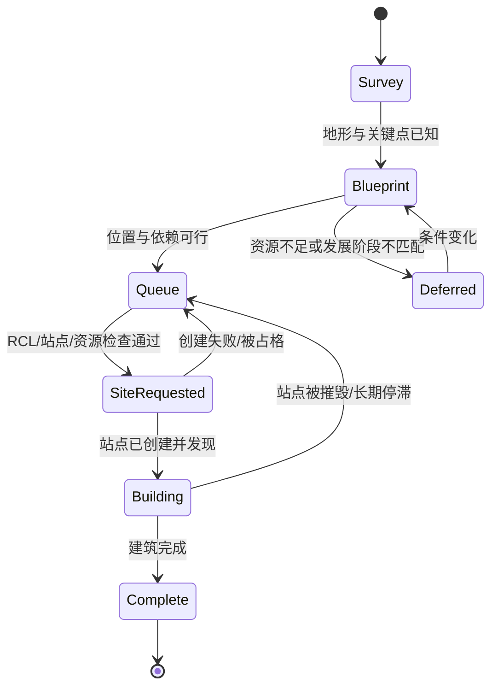

# 17. 建设规划、房间布局、道路与维修系统

## 17.1 为什么建设必须独立于 Builder

`Builder` 是执行能力；`ConstructionPlanner` 才是决定建什么、在哪里建、何时建、为什么建的规划模块。若让每只 Builder 自行挑选最近 Construction Site，系统通常会出现：低价值道路抢占高价值 Spawn 扩展、多个 Builder 堆积在一处、重要建筑位置被提前占用、低优先级站点耗尽站点名额、能源在错误目标上被消耗。

建设规划必须与 RCL 结构上限、资源账本、物流路径、房间布局和战略阶段联动。

## 17.2 模块职责

- `RoomBlueprint`：定义可重复使用的空间规划模板/偏好，包括核心区、资源区、道路走廊、工业区和防御边界。
- `PlacementPlanner`：对候选格子打分，检查地形、已有建筑/站点、通行、邻接和 RCL 权限。
- `ConstructionQueue`：保存计划中的结构目标、优先级、依赖和失败原因。
- `SiteReconciler`：对照当前可见世界，检查站点是否已存在、已完成、失效或被摧毁。
- `BuilderAllocator`：给可用的工作单位分配建造/搬运/维修任务。
- `RepairPlanner`：根据风险、使用率、结构价值和成本选择维修目标。

ConstructionPlanner 生成计划和站点请求；实际建造 API 调用仍由受控执行层提交。

## 17.3 建设规划阶段

重要原则：计划和实际结构分开。一个“期望有 Terminal”的蓝图，不代表 Terminal 已经合法建成；必须以当前 API 的建筑与站点状态校验实际进度。

## 17.4 RoomBlueprint：采用软约束而非僵化布局

房间地形、Source、Controller、Mineral、出口和已有建筑位置各不相同。除非经过可靠的布局优化，不应该要求所有房间使用完全相同的像素级蓝图。

推荐把蓝图拆成“必需功能 + 偏好分区”：

- **核心区**：Spawn、Extension、Storage、Terminal 及主要物流交汇点。
- **Source 区**：采集工作位、Container/Link、可维护的通道。
- **Controller 区**：升级工作位、补给路线与必要容器。
- **工业区**：Labs、Factory、Power Spawn 等可用结构，尽量简化补料路径。
- **防御区**：Rampart 保护线、塔覆盖、出入口和安全撤退空间。
- **交通网络**：连接 Source、Controller、Spawn、Storage/Terminal 的主干路线；减少不必要的道路铺设和交叉堵点。

为每个区域定义坐标候选、结构邻接约束、路网偏好、维修重要性与未来扩展余量。可先用规则评分选址，后续再加入搜索算法。

## 17.5 放置候选格评分

评分因素可以包括：

- 距离关键结构/交通主干的移动成本；
- 是否阻塞固定工作位或预期路线；
- 是否能满足建筑之间的范围/邻接规则；
- 是否靠近威胁边界；
- 后续扩展是否仍有空地；
- 地形与道路建设成本；
- 是否与现有站点、结构或不可通行格冲突；
- 是否需要先铺路或完成前置建筑。

先检查硬约束，再评分。不能靠负分让非法位置“勉强通过”。硬约束至少包括：房间可视、位置范围合法、不是墙、没有禁止占用的结构/站点、当前 RCL 允许、全局/局部结构数量未超限以及 API 明确要求的特殊位置/距离条件。

## 17.6 建设队列排序

可按以下目标排序：

1. 防御和生存：关键 Rampart、紧急道路/维修、必需 Spawn/Extension 能力；
2. 经济闭环：Source/Controller 相关容器、道路、物流结构；
3. RCL 发展所需的基础设施；
4. 可以显著降低运输成本的道路/Link；
5. 工业、市场和中后期优化；
6. 纯美观或当前阶段收益较小的建设。

每个施工项应声明它依赖什么、预计耗资、建成后带来的收益、维护成本与过期条件。资源不足时，允许暂停可选项目，不能让所有 Builder 围着无法推进的任务空转。

## 17.7 道路 ROI

道路建设并非“连接所有格子”。比较长期往返次数、减少的移动成本、道路衰减与维修成本：

`roadValue ≈ expectedTraffic × savedMovementCost − constructionCost − expectedRepairCost`

高频路线、关键瓶颈和长期物流走廊优先；低频侦察路径可继续走地形，不一定值得铺路。道路路线应从真实 Creep 路线和任务频率中学习，而不是只根据几何距离规划。

铺路策略和 PathFinder 成本矩阵应该共享同一份路线信息；否则会发生导航系统使用一条路线、建设系统修建另一条路线的问题。

## 17.8 维修策略

维修目标需要区别对待：

- **正在受攻击/可能破口的防御结构**：按迫近危险与战略后果排序；
- **保护 Spawn/Storage/Terminal 等关键结构的 Rampart**：根据敌方可达性与目标价值设阈值；
- **高流量道路**：根据预计交通价值和损耗率维修；
- **普通建筑**：以成本、用途和失效后果排序；
- **低价值、短期可能被拆除的结构**：避免无效维修。

设置维修目标上限，避免 Builder 把所有墙体无差别修到最大耐久。需要长期维护的结构使用“目标 hits”策略，并随威胁等级调整。

## 17.9 Controller 升级与建设协同

RCL 会解锁建筑容量与能力，因此升级目标应与房间规划同时管理。不要仅追求升级进度，也不应无限升级而没有能源或运输支持。

`DevelopmentPlanner` 可以提出“下一 RCL 需要的基础设施”目标，ConstructionPlanner 给出结构队列，EconomyModel 预测能源投入与回收时间，SpawnDirector 确保足够的工作/运输能力。RCL 8 以后，升级收益与相关规则需按当前官方 API 机制评估，不要沿用低 RCL 的线性思路。

同时监控 Controller 的降级计时：将“维持控制权”作为高优先级生存任务，避免长期规划只顾建设而漏掉升级需求。

## 17.10 失败与恢复

常见失败包括：站点创建返回错误、建筑上限已满、目标格被占、RCL 不够、资源不够、站点被敌人摧毁、施工目标已被其他系统完成。失败必须有分类与下一步动作：

- `invalid_placement`：重新评估候选格；
- `rcl_limit`：推迟并检查发展顺序；
- `site_limit`：清理/排序低价值站点；
- `resource_starved`：暂停并等待账本供给；
- `destroyed`：根据威胁重估是否重建；
- `already_satisfied`：完成队列项并去重。

ConstructionQueue 必须幂等：一个期望结构在同一位置不能因每 Tick 反复执行而产生重复记录。

