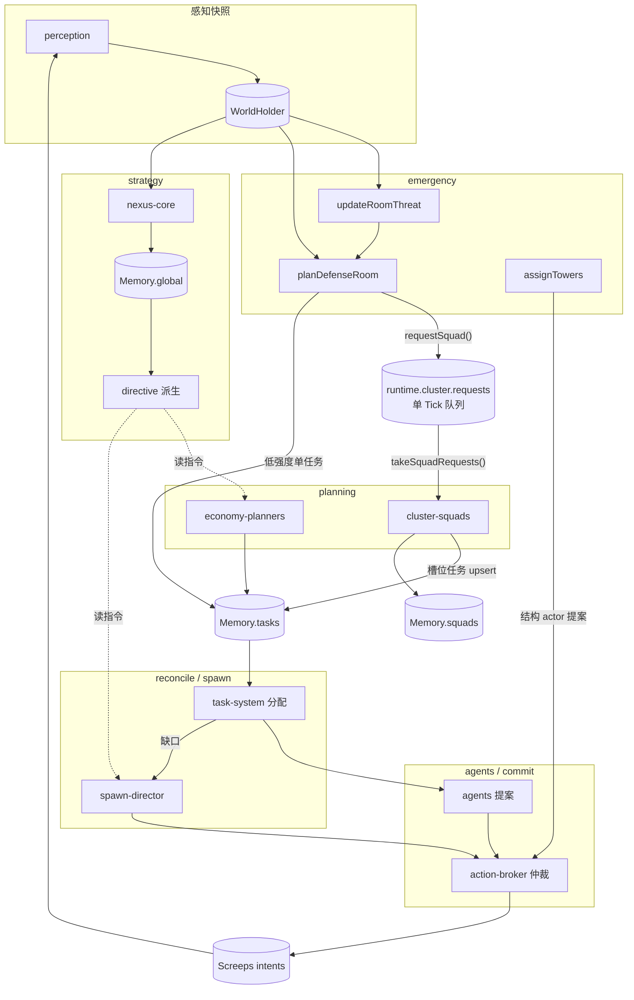

# 20. 智能连结集群：架构、接口与进度

> 本文是「智能连结集群」的架构契约。与 docs/nexus-design/03（总体架构）、docs/nexus-design/19（智械连结分层落地）配套：
> docs/nexus-design/19 定义**分层智能**（战略 → 指令 → 局部规划 → 遥测），本文定义**集群层**（多 Creep 协作编队）。
> 文档与代码同步维护：任一节的实现状态以 §20.7 进度表为准，代码改动必须同 Tick 更新本表。

## 20.1 定位：三个正交概念

「智能连结集群」由三个正交概念构成，落地载体各不相同：

| 概念 | 定义 | 载体 | 代码位置 |
|---|---|---|---|
| **职能系统**（System） | 跨房间的职能域，负责一类事务全流程 | 阶段化的 `TickModule` + 按房间规划入口 | `src/modules/{economy,defense,strategy}/` |
| **连结**（Link） | 层与层之间的**单向指令与反馈通道** | `Memory.global` → `TickContext.directive()`；遥测快照上行 | `src/modules/strategy/{core,directive}.ts` |
| **集群**（Cluster） | 多 Creep 协作编队：共享目标 + 成员槽位 + 生命周期 | 编队记录 + 槽位任务（成员各自租约） | `src/modules/cluster/`、`Memory.nexus.squads` |

关键区分（沿用 docs/nexus-design/19 §19.1 的结论并扩展）：

- **经济是系统，不是集群**：它按房间规划任务，没有"编队"这一协作形态。
- **一支防御编队是集群，不是系统**：它不定义事务全流程，只组织并维持一组单位。
- **连结不是模块**：它是数据流方向约定（指令下行、遥测上行），不是可注册组件。

因此本层**不引入独立的 Cluster 注册层**：集群由单一模块 `cluster-squads` 承载，编队是它管理的数据。

## 20.2 核心组件与职责边界

### 20.2.1 模块总表（注册序 = 同阶段执行序）

| # | 模块名 | 阶段 | 预算带 | 职责 | 禁止 |
|---|---|---|---|---|---|
| 1 | `perception` | perception | P1 | 采集可见房间对象 → 纯数据快照 | 直接命令 Creep |
| 2 | `defense-planners` | emergency | P0 | 威胁观测 → 应急任务 → 塔行动 → 塔能耗折叠 | 直接调用游戏 API；建队 |
| 3 | `nexus-core` | strategy | P2 | 低频重估姿态与政策 → 写 `Memory.global` | 遍历 Game 对象；逐单位微操 |
| 4 | `economy-planners` | planning | P2 | 房间经济任务 upsert（采集/搬运/供能/升级/建造） | 读其他域内部状态 |
| 5 | `economy-model` | planning | P1 | 低频诊断（瓶颈/乘数）与速率回填 | 直接改任务生命周期 |
| 6 | `cluster-squads` | planning | P1 | 消费编队需求 → 建队/续期/解散 → 维持槽位任务 | 直接指挥成员；创建非槽位任务 |
| 7 | `task-system` | reconcile | P1 | 任务对账 + 贪心分配（含编队槽位任务） | 区分任务来源 |
| 8 | `spawn-director` | spawn | P1 | 能力缺口 → 身体 → 排程（含编队成员） | 认政策细节（只认指令视图） |
| 9 | `agents` | agents | P1 | 任务 → 候选行动提案 | 读战略指令 |
| 10 | `action-broker` | commit | P1 | 管线仲裁 + 唯一原生行动调用点 + 结果回填 | 把意图接受当作效果已完成 |
| 11 | `construction-sites` | commit | P2 | 容器/extension/主干道站点落位 | 直接建造 |
| 12 | `visuals` | commit | P0 | HUD/可视化 | 保存无限历史 |

### 20.2.2 集群层的三个文件

| 文件 | 职责 | 不负责 |
|---|---|---|
| `src/config/cluster.ts` | 全部可调参数（上限/TTL/优先级下限） | 任何逻辑 |
| `src/modules/cluster/model.ts` | 编队模型的**纯函数**：id 命名、槽位键、收敛、续期、过期判定 | 读写 Memory；触碰 TaskBoard/Game |
| `src/modules/cluster/index.ts` | 生命周期编排：续期 → 解散 → 维持；快照观测 | 分配单位；提交意图 |

### 20.2.3 需求方与执行形态的分工

| 角色 | 是谁 | 做什么 |
|---|---|---|
| **需求方** | 防御系统（emergency 阶段） | 判断"需要一支编队"，调用 `requestSquad(...)` 声明槽位数/能力/优先级/原因 |
| **执行形态** | 集群模块（planning 阶段） | 建队、续期、解散、维持槽位任务、回填成员 |
| **执行者** | Allocator → AgentSystem → ActionBroker | 分配成员、提案、统一仲裁提交 |

> 编队**不持有**任何单位，也不越过 ActionBroker 提交意图（docs/nexus-design/19 §19.4 指挥层级）。

## 20.3 数据流向



要点：

1. **下行指令**：`Memory.global` → `directive()` → 被职能系统与 SpawnDirector 读取；**Agent 层不读**（执行自治）。
2. **集群请求**：emergency 阶段写入 `runtime.cluster.requests`（global 运行时层，单 Tick 汇总，**不是事件总线**，符合 docs/nexus-design/03 §3.6）。
3. **编队记录**：`Memory.squads`（跨重载持久化，有界 + TTL）。
4. **槽位任务**：`Memory.tasks` 中 `dedupeKey = squad:<kind>:<room>:slot:<n>`，与普通任务走完全相同的分配/提案/仲裁链路。
5. **成员回填**：槽位任务的 `assignedTo` → `squad.members`（**只读回填**，编队不指派单位）。
6. **上行遥测**：`Nexus.cluster()` / `Nexus.defense()` 快照 + HUD 行。

## 20.4 交互接口契约

### 20.4.1 需求方 → 集群（唯一写入口）

```ts
// src/store/runtime.ts
export interface SquadRequest {
  kind: SquadKind;              // 目前仅 "defense"
  roomName: string;
  slots: number;                // 期望槽位数, 集群按 CLUSTER_CONFIG.maxSlotsPerSquad 收敛
  taskKind: TaskKind;           // 槽位任务种类 (成员任务 kind)
  capabilities: string[];       // 每槽位所需能力 → 写入任务 requiredCapabilities
  priority: number;             // 集群按 CLUSTER_CONFIG.priorityFloor 抬升
  reason: string;               // 可归因原因摘要
}

export function requestSquad(request: SquadRequest): void;   // 同 (kind, roomName) 合并, 取较大值
export function takeSquadRequests(): SquadRequest[];         // 消费并清空
```

**契约**：需求方每 Tick 重新声明需求即为"续期"；缺席超过 `CLUSTER_CONFIG.requestTtlTicks` 后编队自动解散。

### 20.4.2 编队记录（持久化形态）

```ts
// src/store/memorySchema.ts
export interface SquadRecord {
  id: string;                   // squad:<kind>:<room>
  kind: SquadKind;
  roomName: string;
  taskKind: TaskKind;
  capabilities: string[];
  slots: number;                // 槽位总数 = 期望成员数
  members: string[];            // 由槽位任务 assignedTo 反填
  priority: number;
  reason: string;
  createdAt: number;
  updatedAt: number;
  expiresAt: number;            // TTL: 无续期即解散
}
```

**持久化约束**（docs/nexus-design/04 §4.4）：纯 JSON，仅 id/坐标/计数，**不保存任何游戏 API 对象引用**。

### 20.4.3 槽位任务命名约定

| 项 | 约定 |
|---|---|
| 编队 id | `squad:<kind>:<roomName>` |
| 槽位任务 dedupeKey | `squad:<kind>:<roomName>:slot:<n>`（n 从 0 起） |
| 命名空间隔离 | 防御规划器只清理 `defend:<room>` / `retreat:<room>` 前缀的任务；集群只清理 `squad:<id>:slot:` 前缀 |
| 成员任务 targetId | 防御类槽位任务**不带** targetId：目标由 Agent 每 Tick 从快照重选（威胁动态变化） |

### 20.4.4 接入一个新编队类型（示例：外矿协作组）

```ts
// 1) 需求方 (任意阶段, 通常 planning/emergency)
requestSquad({
  kind: "remote",                       // 新增 SquadKind
  roomName: "W1N1",
  slots: 3,                             // 矿工 + 搬运 + 护卫
  taskKind: "harvest",                  // 或按槽位分化: 见 TODO C3
  capabilities: ["work", "carry", "move"],
  priority: 70,
  reason: "remote-mine:W2N2",
});

// 2) 其余全部自动生效: 建队/续期/解散/分配/生产/执行都走既有链路, 无需改动集群模块
```

新增 `SquadKind` 需同时：① 扩 `SquadKind` 联合类型（schema 升版本 + 迁移）；② 在 docs/nexus-design/20 §20.7 登记进度。

## 20.5 关键决策记录

| 编号 | 决策 | 理由 | 备选与否决原因 |
|---|---|---|---|
| C1 | 编队**不直接持有单位**，只持有槽位；成员由任务 `assignedTo` 反填 | 复用 TaskBoard 的租约/对账/抢占不变量，避免第二套分配器 | 扩展 `assignedTo` 为编队 ID：需改动全部任务不变量与 Agent 读取路径，风险高收益低 |
| C2 | 请求经 **global 运行时层单 Tick 队列**传递，不用事件总线 | 符合 docs/nexus-design/03 §3.6；丢失去只影响一个 Tick 的续期，TTL 兜底 | 独立事件总线：引入隐藏时序依赖，违背"简单清晰" |
| C3 | 编队记录进 **Memory**（跨重载），请求队列进 **runtime**（重载即失） | 决策状态不可丢、重建廉价数据可丢（docs/nexus-design/19 §19.5 D9 规则） | 编队进 runtime：重载后成员/槽位关系丢失，需重算且原因不可归因 |
| C4 | 高强度威胁（tier=high）**改提编队需求**，低强度仍由规划器直接建单任务 | 单任务不足以应对高强度威胁；低强度用编队是过度工程 | 全部走编队：低强度场景多一层间接，且现有低强度链路已实测可用 |
| C5 | 槽位任务优先级有**下限抬升**（`priorityFloor`） | 编队任务是防御承诺，不应被经济任务抢占 | 直接用需求方优先级：经济繁荣期会被 harvest/haul 挤掉 |
| C6 | 编队解散时**取消**槽位任务而非释放回池 | 需求消失后这些任务无意义，回池会污染分配环 | 释放回池：产生"幽灵防御任务"，被经济单位误领 |
| C7 | 槽位任务**不带 targetId**（防御类） | 威胁目标每 Tick 变化，静态快照必然过期 | 带 targetId：目标死亡即任务失效，产生大量 replan 抖动 |
| C8 | 需求方与执行形态**同模块边界**（防御不建队，集群不判断威胁） | 单一职责；威胁判断只有一处，编队生命周期只有一处 | 防御模块内联建队：职责混杂，新增编队类型要改防御模块 |

## 20.6 各层读取边界（扩展 docs/nexus-design/19 §19.6）

| 层 | 可读 | 禁读 |
|---|---|---|
| `nexus-core`（战略） | 预聚合摘要（诊断/库存/威胁分） | Game 对象实时扫描；编队/任务执行细节 |
| 职能系统规划器 | 房间快照、当 Tick 指令、自身域状态、共享账本 | 其他域内部状态；直接指挥 Creep |
| **编队（集群）** | 编队需求队列、自身编队记录、槽位任务的 `assignedTo` | **威胁评分细节**（由需求方决定要不要建队）；成员私有状态 |
| `spawn-director` | 指令、任务缺口（含槽位任务）、在编/在途计数 | 编队内部结构（只把槽位任务当普通任务） |
| `Agent` | 自己的任务、房间快照、局部反馈 | 战略指令；编队记录（成员无需知道自己在编队里） |

> **设计意图**：编队对成员**透明**。成员执行的是普通 `defend` 任务，因此编队机制可以在不改动 Agent 层的前提下增删。

## 20.7 当前进度与待办

### 20.7.1 进度表

| 项 | 状态 | 证据 |
|---|---|---|
| Memory schema v6 + v5→v6 迁移 | ✅ 完成 | `src/store/memorySchema.ts`、`migrations.ts`；`tests/store/migrations.test.ts` |
| 编队模型纯函数（id/槽位键/收敛/续期/过期） | ✅ 完成 | `src/modules/cluster/model.ts`；`tests/cluster/model.test.ts`（10 例） |
| 编队生命周期编排（建队/续期/解散/维持/收缩） | ✅ 完成 | `src/modules/cluster/index.ts`；`tests/cluster/planner.test.ts`（10 例） |
| 运行时需求队列（合并/有界/自愈） | ✅ 完成 | `src/store/runtime.ts`；`tests/cluster/model.test.ts` |
| 防御系统装配（emergency：观测/任务/塔/统计） | ✅ 完成 | `src/modules/defense/index.ts`；`tests/defense/module.test.ts`（3 例） |
| 防御 → 编队需求接线（tier=high 建队） | ✅ 完成 | `src/modules/defense/planners.ts`；`tests/defense/planners.test.ts` |
| 命名空间隔离（互不取消对方任务） | ✅ 完成 | `tests/cluster/planner.test.ts`「不越权」例 |
| 观测入口（`Nexus.cluster()` / `Nexus.defense()` + HUD 行） | ✅ 完成 | `src/core/boot.ts`；`tests/core/bootSmoke.test.ts` |
| OpenSpec 变更文档（proposal/design/tasks/specs） | ✅ 完成 | `openspec/changes/nexus-cluster-squads/`（含 `specs/cluster-squad`、`specs/defense-assembly`） |
| **编队全链路集成测试（C1 的确定性替身）** | ✅ 完成 | `tests/cluster/e2e.test.ts`（4 例：建队→认领→衰减解散→低强度不建队→重载自愈） |
| **sim 回归（编队全链路实战验证）** | ⏳ 待办（环境阻塞） | 见 §20.7.3：sim 构建在当前环境不可行，已用集成测试覆盖编排正确性 |
| 私服落地验证（W5N8） | ⏳ 待办 | 需在 http://47.100.24.220 落地并轮询 Memory |

### 20.7.2 待办清单（可并行领取）

| 编号 | 事项 | 交付物 | 依赖 | 验收标准 |
|---|---|---|---|---|
| **C1** | sim 回归：高强度威胁场景下编队建队→成员分配→defend 执行 | 场景 JSON + 回归记录 | sim 构建可用（**当前环境阻塞**，见 §20.7.3） | 编队 slots 全部被认领；威胁衰减后编队解散且槽位任务 cancelled |
| **C2** | 私服落地验证（W5N8） | 落地记录 + Memory 取证 | 无 | `Nexus.cluster()` 可查；转移日志无异常 |
| **C3** | 异构槽位（不同槽位不同能力/任务种类） | `SquadRecord.slots` → 槽位定义数组 | C1 | 矿工+搬运+护卫混合编队可按槽位分化 |
| **C4** | 编队内领队逻辑（集火/拉扯） | 编队级共享目标 | C3 | 不越过 ActionBroker；有指标证明收益 |
| **C5** | 外矿协作组（`SquadKind = "remote"`） | schema v7 + 需求方接入 | C3、docs/nexus-design/10 落地 | 远程采集净收益为正 |
| **C6** | 编队收益指标（协同前后战损/击杀对比） | 指标入 telemetry | C1 | 无证据的"智能"不上线（docs/nexus-design/02 原则 F） |

> **C1 进展**：编排正确性已由 `tests/cluster/e2e.test.ts` 覆盖（建队 → 槽位被认领 → 威胁衰减 → 解散 + cancelled，含低强度不建队与重载自愈对照）。**尚未覆盖**的是 sim 的真实时序/吞吐（V8 结算语义下的成员就位耗时、CPU 占用）。

### 20.7.3 已知阻塞与风险

- **sim 构建（当前环境不可行）**：`sim/` 为 Rust + deno_core（内嵌 V8）。其 `v8` crate 构建脚本需先取得 `librusty_v8.a`，两条路径均不通：
  1. **预编译产物下载**：默认从 GitHub Release 拉取 `librusty_v8_release_x86_64-pc-windows-msvc.a.gz`，当前网络对该主机不可达（`curl` 返回 HTTP 000，连接挂起 20min 后 `.tmp` 仍为 0 字节）；npmmirror 无 `rusty_v8` 镜像（404）。
  2. **源码构建**：回退到 gn/ninja 从源码编译 V8，需 clang/gn（本机仅有 Anaconda 的 `ninja`，无 clang），且耗时 ~1h。
  → 因此 §20.7.1 的 sim 回归项保持"待办"。替代验证见 `tests/cluster/e2e.test.ts`（编排层）与 C2 私服验证（真实结算层）。
- **Windows 开发环境**：`node_modules` 的原生二进制为 linux-x64，Windows 侧需补装 `@rolldown/binding-win32-x64-msvc` 与 `@typescript/typescript-win32-x64` 才能跑 typecheck/test/build（工具经 `node node_modules/.../xxx` 直调，npm scripts 失效）。
- **未验证声明**：本层所有"✅ 完成"仅由单元/集成测试支撑；**尚未经过 sim 与私服实战验证**，因此不得据此声称"性能提升"。

## 20.8 验收对齐（docs/nexus-design/02 §2.7 七问）

| 问题 | 回答 |
|---|---|
| 1. 需要什么输入？哪些会过期？ | 输入 = `SquadRequest`（单 Tick 队列，超 TTL 即视为过期）+ `Memory.squads`。过期处理：TTL 到期解散 |
| 2. 属全局战略 / 房间 Cluster / 单个 Agent？ | 房间级协作形态（集群层），介于战略与 Agent 之间 |
| 3. 最坏 CPU 成本？ | O(编队数 × 槽位上限 + 该房间同类任务数)；编队数 ≤ 4、槽位 ≤ 4，且有界清理 |
| 4. 目标消失 / Creep 死亡 / 失视？ | 目标：防御槽位任务不带 targetId，Agent 每 Tick 重选；死亡：任务租约由对账释放，成员回填自动收缩；失视：威胁记录按 lastSeen 衰减，需求方停止续期 → 编队 TTL 解散 |
| 5. 会修改 Memory 吗？schema 与清理政策？ | 改 `Memory.squads`（schema v6）；清理 = TTL 解散 + 编队数上限 + 槽位上限 |
| 6. 成功如何测量？失败如何记录？ | 测量：成员就位率（`members.length / slots`）、编队存活时长、威胁窗口战损；记录：`reason` 归因 + 解散原因（`squad-disbanded`/`squad-shrunk`），限频日志 |
| 7. 是否直接调用游戏 API？ | 否。集群模块零游戏 API 调用，意图一律经共享 ActionBroker |
