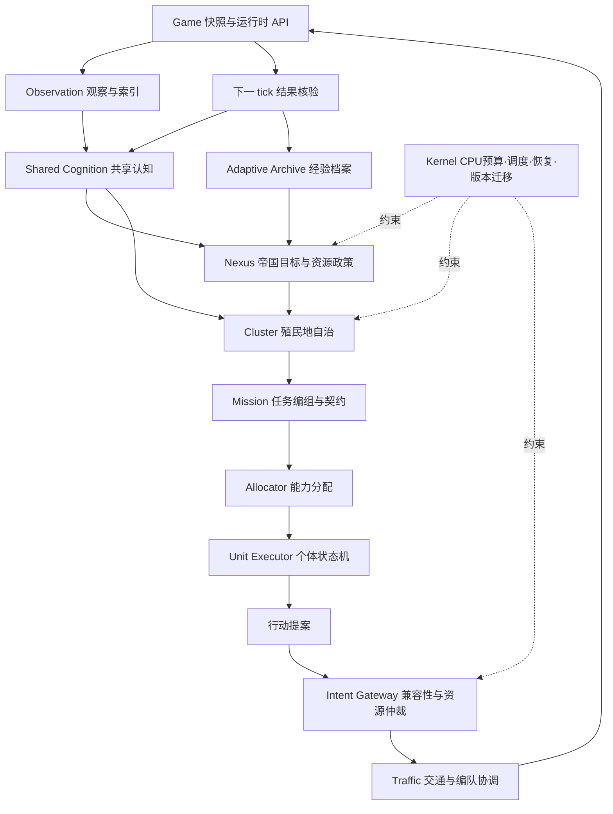

# EX MACHINA：Screeps 机凯种集群 Bot 架构设计

> ---
> ## 项目导读 (Nexus-Bot 收录裁决, 2026-10-12)
>
> **定位**: 本篇是 Nexus-Bot 的**总参照蓝图**——设计参照系与验收语言, 不是逐字实施规范。
> 01-18 是实施规范, 19-22 是架构扩展与公约, 本篇统摄其上: 冲突时以实施文档为准, 模糊时以本篇为准。
>
> ### 与现行实现的映射 (蓝图概念 → 本项目落点)
>
> | 蓝图概念 | 本项目落点 | 状态 |
> |---|---|---|
> | L0 Runtime Adapter | 引擎全局 + actionBroker 唯一原生调用点 | ✅ 简化实现 (无独立适配层, docs/22 §22.4 裁决) |
> | L1 Kernel | `core/` (nexus/phases/cpuBudget/errorBoundary/scheduler) | ✅ |
> | L2 Shared Cognition | `core/world` 快照 + `Memory.nexus.rooms` Intel | ✅ 三级 (快照/持久/临时), Knowledge 类型对齐中 |
> | L3 Nexus 帝国层 | `modules/strategy` (posture + directiveFor) | ✅ 最小版 |
> | L4 Cluster | `modules/cluster` + 各域 planner | ✅ 防御编队起步 |
> | L5 Mission | `modules/tasks` (17 kind + dedupeKey + 租约) | ✅ |
> | L6 Unit Executor | `modules/agents/agentSystem` (产行动提案) | ✅ |
> | L7 Intent Gateway + Traffic | `modules/agents/actionBroker` + `modules/movement` | ✅ 管线仲裁 + BetterMove |
> | Adaptive Archive | economy 诊断/账本速率/travel P95 | ✅ 萌芽 (§8.6 为演进方向) |
> | §11 建议目录 | **部分采纳** — 已结合进 docs/21 §21.1: 平铺目录域化收进 `modules/` (上表即映射), 未来域 external/industry/teams/intershard/adaptation 已立名, 不预建空目录 | 🟡 |
>
> ### 采纳决定 (关键条目)
>
> - **词典序优化顺序** (§1.3) → 采纳为规划总纲: 避免灭亡 > 资源闭环 > 保证履约 > 降低浪费 > 增长竞争。
> - **四状态行动模型** (§3.1: Proposed/Accepted/Submitted/Observed) → 采纳为 docs/05 行动契约语言;
>   "OK ≠ 完成、下一 tick 观察确认" 已是 actionBroker 现行语义。
> - **孵化负载 ρ 与接班最晚启动公式** (§3.4) → 吸收进 docs/07。
> - **运输流量下界 q×T** (§3.5) → 吸收进 docs/06。
> - **四类承诺** (§9.1: 单位/资源/产能/空间) → 吸收进 docs/05。
> - **系统状态四档** (§6.3: Normal/Constrained/Critical/Recovery) → 吸收进 docs/12, 与 P0-P3 带互补。
> - **十条核心不变量** (§12.4) 与**场景测试表** (§12.2) → 吸收进 docs/13。
> - **阶段 A-F** (§13) → 与 docs/14 Phase 0-7 建立映射。
> - **不采用清单** (§14) → 全部与本项目裁决一致 (docs/22 同源结论)。
>
> ---

> 版本：0.1 / 2026-10-12  
> 定位：面向 Screeps: World 的工程设计蓝图，不是可直接部署的完整 Bot。  
> 技术基线：TypeScript、单 shard 内集中式 tick 执行、分层自治、多 colony 扩张。  
> 灵感来源：《游戏人生》机凯种的智械连结、共享认知、解析与适应。本文将其转译为工程机制，不将文学设定当作游戏规则。

---

## 0. 执行摘要

Screeps 不是“写几个角色让单位干活”的游戏，而是一个**有计算预算、观察盲区、生产时延和对抗环境的持久自治系统**。真正的竞争力来自闭环：

**观察世界 → 判断约束 → 分配资源 → 提交行动 → 验证结果 → 修正模型。**

建议采用以下架构：

- **Nexus 联结中枢**：保存帝国目标与跨殖民地资源政策，不逐个遥控 creep。
- **Shared Cognition 共享认知**：统一事实、情报、预测和不确定性，避免各模块重复观察与相互矛盾。
- **Cluster 殖民地集群**：以主房间及其外矿为生产与生存边界，拥有局部自治权。
- **Mission 任务编组**：把“采矿、开荒、运输、防守、攻坚”组织为带目标与资源预算的任务，而不是永久角色。
- **Unit 个体执行器**：根据身体能力和当前契约执行有限状态机，不进行昂贵的全局规划。
- **Intent Gateway 行动网关**：统一仲裁移动、动作冲突和资源承诺，受控地调用游戏 API。
- **Adaptive Archive 适应性档案**：跨 tick 保存结果与有效策略，进行低成本在线调整及离线评估。

架构形态是：**共享黑板 + 分层控制 + 任务契约 + 预算调度 + 显式行动仲裁**。

不是在每个 creep 里跑一个完整智能体；不是用分布式共识模拟连结；不是把大模型调用放进游戏循环。

---

## 1. 范围、事实等级与设计目标

### 1.1 默认范围

本文默认 Screeps: World 持久世界，不直接套用 Screeps: Arena 的回合、资源与 API。优先完成单 shard 内的单房间生存和多房间自治，再扩展跨 shard 协作。私服、赛季或模组应通过规则适配层处理。

本文不预设玩家 CPU 档位、现有 GCL、房间数量或战争目标。调度器应读取运行时限制，而不是写死“20 CPU 一定够用”。

### 1.2 事实等级

- **已核对机制**：tick 快照、延迟结算、动作冲突、CPU bucket，依据文末官方文档。
- **标准规则基线**：正文中的身体、经济、寿命等常用数值用于容量推导；实现必须优先使用运行环境常量和 API，并在目标服务器验证。
- **设计决策**：集群层次、契约格式、预算比例、退化策略等均是本方案建议，不是游戏内置机制。
- **待实验参数**：路径拥堵权重、危险阈值、储备天数、重算周期等不能靠纸面分析宣称最优。

### 1.3 优化顺序

采用词典序优先级，而不是把所有目标塞进一个不透明加权分数：

1. 避免灭亡：不失去关键 spawn、维持 controller、生存补员。
2. 保证资源闭环：采集、运输、补能、spawn 能持续运转。
3. 保证履约：关键任务有足够执行能力与可用 CPU。
4. 降低浪费：减少空跑、溢出、重复寻路、无效行动。
5. 增长与竞争：升级、扩张、工业、交易、战争。

先满足硬约束，再在可行解内优化收益。少采一点矿通常好过省 CPU 省到失去防御。

---

## 2. 游戏设计：Screeps 究竟在考验什么

### 2.1 持续在线：可靠性本身就是战斗力

玩家离线时世界仍运行。一次错误的 spawn 队列、空运输链或 controller 维护遗漏，可能在多个生命周期后演化成灭亡。

因此目标不是单 tick 最优，而是长期稳定、失败可恢复、能在局部信息下持续运行。Bot 必须包含自举、监控、降级和恢复机制。

### 2.2 身体是一种可编程资本

Creep 的身体同时决定生产成本、孵化占用、行动能力、机动性和风险暴露。造大单位不等于效率最高：

- 大单位可能减少单位数和脚本开销；
- 但占用更长 spawn 时间，更难调配，死亡损失更集中；
- 大载重若无法及时装满，就是浪费；
- 战斗身体还涉及身体顺序、受伤后能力保留、治疗与 boost。

因此身体应由任务约束生成，而不是所有 RCL 共用一组固定模板。

### 2.3 空间是经济系统的一部分

距离、道路、地形、出口、窄口与房间边界会转化为运输成本、增援时延和拥堵。

布局不是装饰。采矿点到容器、容器到存储、存储到 spawn 的路线，决定了单位需求和能量净收益。道路建设应有收益回收分析，而不是无条件铺满。

### 2.4 能量是主循环，CPU 是元资源

能量生产 creep，creep 获取能量、建造、升级和防御。CPU 决定可以维持多复杂、多大规模的自治系统。

CPU 过度投入路径计算和全图扫描，可能挤掉补员与防守。因此不仅要问“这个任务赚多少能量”，还要问“每 tick 要占多少 CPU、spawn 时间和运输容量”。

### 2.5 不完全信息使侦察具有经济价值

不可见房间不能当作有实时对象的房间处理。历史情报必须带采集时间、来源和有效期。外矿曾经安全，不等于现在安全。

侦察的价值是减少决策失误：避免把运输队送进敌军，避免对不存在的资源投产，避免过晚发现入侵。

### 2.6 多时间尺度构成真正的复杂性

- tick 级：移动、攻击、治疗、补能。
- 数十 tick：运输轮次、局部避障、短期增援。
- 数百至上千 tick：孵化周期、单位换代、开荒、布局维护。
- 更长周期：扩张、工业链、战略储备、长期对抗。

不能每 tick 重新解决所有层级问题。应当让高频执行稳定，让低频规划有预算、可分片、可中断。

---

## 3. 关键规则及其架构后果

### 3.1 Tick 是快照—提交—结算，不是即时指令环境

官方游戏循环描述中，本 tick 脚本读取的是 tick 开始时的局面；指令集中处理，结果在后续状态中体现。

例如：本 tick `move()` 后调用 `attack()`，攻击范围仍按原位置判断，不能按预计移动后的坐标判断。

**必须区分四个状态：**

1. Proposed：模块提出行动建议。
2. Accepted：Bot 内部仲裁通过。
3. Submitted：API 接收指令，返回值只说明本次调用的受理结果。
4. Observed：下一 tick 观察到预期变化。

`OK` 不等于世界已经按计划改变，也不等于没有结算冲突。

**设计后果：** WorldView 只读；预测写入独立预测账本；任务完成由下一 tick 观察或可靠终止条件确认，不通过“API 返回 OK”直接推断。

### 3.2 动作并非“每个 creep 只能做一件事”

不同动作存在官方定义的兼容和优先级关系。移动、某些战斗动作及资源动作可以组合；冲突动作可能覆盖；同一方法重复调用通常由最后一次有效调用占优。

官方示例还指出，多个涉及 CARRY 的动作不能假定共享一个在脚本中逐步更新的背包状态。

**设计后果：** 不使用粗暴的“一个 creep 一个 action 槽”，而采用：

- movement：最终只有一个移动意图；
- per-method uniqueness：同一方法只提交一次；
- compatibility rules：依据实际 API 的冲突矩阵筛选组合；
- resource feasibility：用 tick 初始资源和保守承诺校验组合；
- target validity：检查目标存在、范围、身体与冷却条件。

冲突矩阵应作为独立数据和测试存在。未验证的组合宁可保守禁止，不能凭“WORK、CARRY、HEAL 分组”猜测引擎行为。

### 3.3 Creep 是有限寿命的能力集合

标准基线：普通 creep 寿命通常为 1500 tick；含 CLAIM 身体的 creep 通常为 600 tick；身体上限 50 部件；常规 spawn 每部件需要 3 tick。

常见部件成本：MOVE 50、WORK 100、CARRY 50、ATTACK 80、RANGED_ATTACK 150、HEAL 250、TOUGH 10、CLAIM 600 能量。

未 boost 的常见能力：WORK 对能量源每 tick 采集 2，CARRY 每部件提供 50 容量，MOVE 每部件每 tick 消除 2 fatigue。实际能力必须考虑受损部件、boost、负载和当前环境。

**设计后果：**

- CapabilityResolver 计算实时能力，不只读取出生时角色。
- PopulationPlanner 根据退休时间和路线时延提前补员。
- BodyCompiler 根据预算、地形、任务需求生成身体。
- 不把 1500 tick 全部当作有效工作时间；路程和准备会消耗寿命。

### 3.4 孵化器是一条有交期的生产线

Spawn 不只是“有能量就造兵”。即使储备足够，产能不足也会导致采矿断档。

对单位类型 i 定义：身体部件数 bᵢ、目标数量 nᵢ、实际平均替换间隔 Lᵢ：

`长期孵化负载 ρ = Σ(nᵢ × 3bᵢ / Lᵢ) / 可用 spawn 数`

这是稳定性检查，不是精确排程。ρ 接近 1 意味着几乎没有应对战损或新增任务的余量。多 spawn 也不意味着所有能源、位置和任务约束都能完全并行。

补员的最晚启动时间应近似为：

`接班截止 tick - 孵化时间 - 行军时间 - 准备时间 - 安全余量`

排程要综合优先级、截止时间和可行性；不能让高价大身体永久阻塞低价救命单位。

### 3.5 运输需要流量模型，不需要凭感觉配比例

标准自有/被预定房间的典型能量源可按 3000 能量、300 tick 再生周期建立 10 能量/tick 的基线；中立无预定房间等情境容量不同，不能将该基线推广到所有房间。

设实测可交付流量为 q，装卸与移动构成的往返周期为 T，则：

`所需总载重 ≥ q × T`

若每个有效 CARRY 容量为 50，则总 CARRY 下界约为 `ceil(qT/50)`。再考虑路径拥堵、装载波动、替换重叠和危险停工。

示例：q=10，往返及装卸共 52 tick，则下界 520 容量，即 11 个 CARRY；这是估算，不等于应生成单个 11 CARRY 身体。身体还要满足 MOVE、能量与 spawn 约束。

**设计后果：** 运输系统以供给率、需求率、缓冲区和路线为模型，运输者只是被分配的执行能力。

### 3.6 Fatigue 让“格数距离”不等于“到达时间”

移动的疲劳受道路、平原、沼泽及身体负担影响；空载 CARRY 与载货时不同，受伤与 boost 也会改变速度。

应分别估算去程与返程，而不是将路径长度乘二作为准确周期。早期可使用保守地形模型，后期以实际行程的滑动统计修正。

同一路径可能对空载运输者便宜，对重载运输者昂贵，对慢速军团不可接受。

### 3.7 房间等级、全局等级与生存责任不同

- RCL 决定房间内建筑能力和发展阶段。
- GCL 影响可控制房间数量等全局扩张约束。
- 房间需要持续维护 controller，不能无限停止升级而不关心降级计时。
- 升级投入既是成长投资，也与最低生存维护有关；二者应分开预算。
- 标准规则下高级房间升级存在额外约束，例如 RCL8 的常规升级上限；实现应读取对应常量并考虑 power 效果，而不是无限增加 upgrader。

**设计后果：** 开荒、升级、维护是不同任务。扩张必须检查 CPU、GCL、spawn 余量、支援距离与能量储备，不以“能 CLAIM”作为唯一条件。

### 3.8 战斗是组合约束，不是比较总战斗部件

战斗效果取决于射程、位置、地形、有效部件、治疗、boost、塔的距离衰减、屏障和增援时间。

防御至少包括：发现 → 分类 → 评估突破时间 → 调配塔和防守者 → 撤离非战斗者 → 满足条件时考虑安全模式 → 恢复。

安全模式是受条件、可用次数及冷却限制的应急手段，不能写成任何危险都能触发的绝对保险。

**设计后果：** 使用保守伤害/治疗估计和危险区域，而不是一个敌人数量阈值。战斗仿真应低频、限预算，只对少量候选动作评估，不能全局穷举。

### 3.9 CPU bucket 是缓冲，不是常态预算

官方说明 CPU 限制可通过 `Game.cpu.limit`、`Game.cpu.tickLimit`、`Game.cpu.bucket` 读取。Bucket 标准上限为 10000；可用 burst 受当前 tickLimit 限制，不能把 bucket 大小当作单 tick 配额。

过度消耗会导致脚本被终止，后续维护与行动可能没有执行机会。

**设计后果：** 生存动作尽早提交；重规划最后执行；关键开销前留足余量；按实测耗时判断可执行工作量。

### 3.10 Memory、堆缓存与跨 shard 状态不能混为一谈

建议采用四层存储：

| 层 | 内容 | 生命周期 | 丢失处理 |
|---|---|---|---|
| TickContext | 本 tick 快照、报价、预留 | 单 tick | 下 tick 重建 |
| GlobalCache | 索引、路径矩阵、编译后策略 | 跨 tick 但可能 reset | 从持久数据渐进重建 |
| Memory | 任务、单位绑定、版本、必要情报 | 持久化 JSON | 校验、迁移、修复 |
| RawMemory segments | 大型冷数据和压缩档案 | 持久，需按 API 激活 | 延迟加载，不能依赖立即可用 |

不要将 Game 对象存入 Memory；只保存 ID、位置、标识和必要原始数据。下一 tick 重新解析引用，接受目标不可见或已消失。

跨 shard 应把各 shard 看作独立运行域。InterShardMemory 是消息/状态交换机制，不是共享堆，不提供跨 shard 原子事务。应使用消息 ID、序号、确认、超时与幂等协议；不要比较不同 shard 的 `Game.time` 来直接判定全局先后。

---

## 4. 把机凯种灵感转化为可落地机制

### 4.1 不是设定复刻，而是结构映射

| 创作灵感 | 工程含义 | 明确不做什么 |
|---|---|---|
| 智械连结 | 同 shard 共享世界黑板和情报索引 | 不在每个单位间复制完整数据库 |
| 个体是集群的一部分 | 单位绑定可撤销任务，能力可被重编组 | 不把永久 role 当作身份本质 |
| 解析敌人 | 收集身体、boost、行动轨迹、威胁特征 | 不假装能读取敌方脚本 |
| 适应与复用 | 策略模板、参数更新、失效检测 | 不在在线 tick 内训练大型模型 |
| 集群共识 | 统一目标与行动仲裁、局部反馈 | 不实现 Raft/Paxos 等无必要共识 |
| 单体牺牲 | 明确预算的诱导/掩护/撤退任务 | 不默认用高成本单位换取零收益 |
| 连结受限后自治 | 信息过期时的本地保守策略 | 不假设 creep 会自动独立运行代码 |

Screeps 中 creep 不是真正各自运行的进程。所谓“失联自治”是 Bot 在看不到目标区域、中央规划暂停或任务失效时，仍为该单位执行的简化 fallback；如果整个脚本被终止，它并不会凭架构名义继续思考。

### 4.2 三种连结

**认知连结**：共享事实与不确定性。每条情报包含 observedAt、source、confidence、expiresAt 或失效规则。

**执行连结**：共享任务、资源和空间承诺。两名运输者不能同时拿同一份货；战斗编队不能给一个治疗者安排互斥的跟随位置。

**演化连结**：把任务结果反馈给策略。一次道路拥堵不立即推翻全局布局；持续证据才更新参数。

### 4.3 集中目标，分散细节

Nexus 只下达结果约束，例如：

> A 集群保持最低防御储备，在不降低生存保障的前提下，每 100 tick 为 B 集群提供指定资源；B 必须在给定窗口前形成自维持采运能力。

A 如何选运输者、何时补货，由本地 Cluster 决定。冲突只在确实共享的资源边界上仲裁。

这比每 tick 由全局管理器为所有 creep 逐个指定动作更稳定，也更便于测试。

---

## 5. 分层架构与模块边界



### L0：Runtime Adapter 运行时适配

唯一接触 Game、Memory、RawMemory、常量和对象解析的基础入口。生产环境和测试环境共享接口，不直接把模拟对象传遍业务代码。

职责：世界读取、ID 解析、能力计算、意图 API 封装、CPU 计量、持久化接口。

### L1：Kernel 内核

职责：tick 编排、CPU 预算、调度、模块隔离、版本迁移、熔断、紧急恢复。

约束：捕获普通模块异常不等于可以捕获 CPU 硬超时。硬超时必须靠预防与降级，而不是 try/catch 保证。

### L2：Shared Cognition 共享认知

职责：一次性构建必要索引；维护可见事实、历史情报、威胁与路线摘要。

数据类型必须区分 `Observed<T>`、`Estimated<T>` 与 `Unknown`，避免调用者把陈旧情报当作实时状态。

不把所有可导出数据都存下来；高频派生量优先在堆中缓存，大量历史只保留聚合。

### L3：Nexus 帝国层

职责：目标排序、扩张、跨集群援助、资源储备政策、战争授权。

运行：低频或事件触发。中央规划未运行时，各集群继续执行已下达政策；新政策包含版本和适用期限。

### L4：Cluster 集群层

一个主房间及其外矿/哨点构成默认集群。主房间失效、距离过远或支援关系改变时可以重建归属。

包含 Economy、Population、Infrastructure、Defense、Logistics 控制器。它们提出需求，不直接争抢同一 creep。

### L5：Mission 任务层

任务示例：HarvestSource、MaintainController、SupplySpawn、RemoteMine、BootstrapColony、DefendRoom、Evacuate、Siege。

任务必须声明目标、优先级、截止时间、资源预算、能力需求、失败条件、完成条件和中断策略。

### L6：Unit 个体层

执行小而明确的状态机。例如运输：Acquire → TravelToPickup → Load → TravelToDropoff → Unload → Reconcile。

单位不自行决定开启战争或开辟新矿，只可在契约允许范围内局部调整，例如换邻近卸货点或临时躲避。

### L7：Intent Gateway 与 Traffic

所有改变游戏世界的 creep/structure API 由网关调用。执行器只产生意图提案，避免后续模块无意覆盖前面模块。

网关内部包含：动作兼容规则、同方法去重、资源账本、移动协调、结构动作适配、提交日志。

移动协调必须在统一移动提交前运行，不能让各单位先 `moveTo()` 再补做冲突消解。

---

## 6. Tick 流水线：不要把关键动作押在最后

### 6.1 推荐顺序

1. **Boot / Recover**：检查 schema，挂载可用缓存；不在冷启动时重建全帝国。
2. **Observe**：读取关键状态，构建当前可见世界的必要索引。
3. **Reconcile**：根据当前观察核验上 tick 的任务与行动结果，回收过期租约。
4. **Safety Pass**：检测迫近危险、controller 风险、采运断供、spawn 灭绝链。
5. **Critical Plan & Commit**：先规划并提交紧急防御和最小生存动作，锁定已提交的 actor/方法/资源。
6. **Local Control**：运行集群维护，沿用有效计划，更新契约。
7. **Allocate & Execute**：增量分配单位，运行个体状态机。
8. **Normal Arbitration & Commit**：普通动作和交通仲裁，不能覆盖已锁定的关键提交。
9. **Strategic Maintenance**：有剩余预算才运行布局搜索、长程规划、冷数据维护。
10. **Persist & Metrics**：保存必要状态和聚合指标。

重要持久状态应在流程中增量维护，不能假定最后一步永远有机会执行。尤其不能把“已提交”写成“已成功”，必须允许下 tick 纠正。

### 6.2 示例接口，不是完整生产代码

```ts
export function loop(): void {
  const ctx = kernel.beginTick();
  reconciler.run(ctx);

  const critical = safety.plan(ctx);
  gateway.commitCritical(critical, ctx);

  scheduler.runDueControllers(ctx);
  const assignments = allocator.update(ctx);
  const proposals = executors.propose(assignments, ctx);
  gateway.commitNormal(proposals, ctx); // 包含交通仲裁及已提交动作锁

  scheduler.runOptionalJobs(ctx);
  kernel.finishTick(ctx);
}
```

此处省略了具体实现。`beginTick`、观察、协调和提交自身也必须预算化。不能在前半段烧尽 CPU 后再依赖 `runOptionalJobs` 自觉退出。

### 6.3 预算与降级

设 L 为长期 CPU 基线，T 为本 tick 可用上限，B 为 bucket。使用平滑的实测开销估计，并预留提交与序列化空间。

不要将“允许花到 T”当成“应该花到 T”。平时消耗应低于可持续预算；只有冷启动、严重威胁或规划窗口才有控制地动用 bucket。

| 状态 | 保留 | 暂停或缩减 |
|---|---|---|
| Normal | 所有必要循环，受控战略任务 | 无界搜索永远禁止 |
| Constrained | 生存、现有任务、已缓存路线 | 装饰性 visuals、全局优化、低收益建设 |
| Critical | 防御、最小采运、紧急补员、controller 维护 | 非必要扩张、工业优化、重规划 |
| Recovery | 本地恢复与稳定供能 | 批量重建所有缓存、远程复杂任务 |

阈值由账户 CPU 与实际负载标定，而不是给所有玩家一组固定 bucket 数字。

---

## 7. 核心数据契约

### 7.1 设计原则

ID 稳定、引用可失效、状态可迁移、字段有来源。禁止在 Memory 中存类实例、函数、循环引用或完整 Game 对象。

以下 TypeScript 是领域接口示意，不声称已与某一版本 Screeps 类型定义完整编译适配。

```ts
type Tick = number;
type ClusterId = string;
type MissionId = string;
type UnitName = string;

type Priority = "survival" | "defense" | "production" | "growth" | "optional";

type Knowledge<T> =
  | { kind: "observed"; value: T; observedAt: Tick }
  | { kind: "estimated"; value: T; observedAt: Tick;
      confidence: number; validUntil: Tick }
  | { kind: "unknown" };

interface CapabilityDemand {
  kind: "harvest" | "carry" | "build" | "upgrade" | "attack" | "heal" | "claim";
  amount: number;
  unit: "energyPerTick" | "capacity" | "powerPerTick" | "claimParts";
}

interface MissionRecord {
  id: MissionId;
  clusterId: ClusterId;
  type: string;
  state: "proposed" | "recruiting" | "active" | "suspended"
       | "succeeded" | "failed" | "cancelled";
  priority: Priority;
  demands: CapabilityDemand[];
  createdAt: Tick;
  deadline?: Tick;
  version: number;
  payload: Record<string, unknown>;
}

interface AssignmentLease {
  unit: UnitName;
  missionId: MissionId;
  missionVersion: number;
  slot: string;
  expiresAt: Tick;
  interruptible: boolean;
}

interface Reservation {
  id: string;
  missionId: MissionId;
  resource: string;
  endpointId: string;
  direction: "withdraw" | "deposit";
  amount: number;
  expiresAt: Tick;
}
```

生产版本应把 `payload` 改为按任务类型区分的联合类型，并给数据加运行时校验；不能仅靠 TypeScript 保证旧 Memory 的合法性。

### 7.2 量纲必须明确

`carry: 10` 可能是 10 个部件，也可能是 10 容量或每 tick 10 吞吐。混用会造成隐蔽错误。

需求统一写出量纲。能力分配先计算身体可提供的有效能力，再把路线与寿命因素转为可交付能力。

### 7.3 Memory 建议结构

```ts
interface BotMemory {
  schemaVersion: number;
  config: Record<string, unknown>;
  empire: { policyVersion: number; objectives: string[] };
  clusters: Record<string, unknown>;
  missions: Record<string, MissionRecord>;
  units: Record<string, {
    clusterId: ClusterId;
    lease?: AssignmentLease;
    executorState: string;
  }>;
  intel: Record<string, unknown>;
  spawnPlans: Record<string, unknown>;
  transferProtocols: Record<string, unknown>;
  stats: Record<string, number>;
}
```

不保存每 tick 全量事件流。大型档案只保留聚合、采样、近期窗口及少量异常案例。

---

## 8. 六个决定实际强度的子系统

### 8.1 Economy：从“角色数量”转向流量平衡

建立资源网络：源 → 矿点缓冲 → 中央储备 → spawn/extension、塔、建造、升级、工业。

每个端点声明供给量、需求量、最低库存、紧急度和有效期。

优先级不应完全固定为“塔永远第一”：和平时塔已达储备，就应让出预算；入侵时防御储备和补员可能优先于升级。

将能量划分为生存底线、生产周转、防御储备与可支配盈余。升级和扩张通常使用盈余，而不是争抢最后一份救命能量。

闭环指标：源利用率、丢失/溢出、运输空驶、spawn 缺能等待、controller 余量、净能量收益。

### 8.2 Population：能力缺口、退休预测、截止时间

流程：

1. 汇总任务能力需求；
2. 扣除可在目标时间窗内到位的存量能力；
3. 扣除正在孵化且已承诺给该任务的能力；
4. 识别未来退休造成的缺口；
5. 编译若干可行身体；
6. 按期限和资源约束安排生产；
7. 生存紧急时降级为可立即生产的小身体。

禁止只看当前 creep 数量。一个寿命只剩 20 tick 的矿工和一个刚出生矿工，不是同等的未来产能。

### 8.3 Logistics：双端预留与弹性履约

运输任务不是“去最近容器拿能量”，而是一个有取货端、卸货端和交付数量的契约。

需要同时防止：

- 多个运输者领取同一份供给；
- 多个运输者填满同一个剩余容量；
- 目标被摧毁后单位永久等待；
- 任务撤销后仍保留预留；
- 中途遇敌后所有规划仍认为货物会准时到达。

Tick 级资源账本与跨 tick 任务承诺应分开。持久预留是可过期租约，不是假装世界资源已被锁住；每 tick 根据真实存量与到达预期调整。

分配方法初期采用局部贪心 + 有效期 + 切换惩罚。规模足够大且实测有收益时，再加入有限范围匹配或最小费用流；不每 tick 求全帝国最优解。

### 8.4 Traffic：道路是共享调度资源

路径层次：房间路线 → 房内静态路径 → tick 级拥堵协调。

- 静态层：地形、建筑、道路、永久禁行区。
- 动态层：creep 占用、敌方威胁、临时禁行和队形。
- 缓存键：地形/建筑版本、移动规格、目标范围、策略版本。
- 失效条件：连续受阻、布局变化、威胁变化、目标变化。

每个单位提交期望下一格、备选格、优先级、能否让路。协调器构建移动依赖，处理己方可控单位之间的让行和局部环；敌方或不可控占用按不确定阻塞处理。

不能宣称“发出了交换移动所以一定成功”。所有移动都要在下 tick 检查实际位移。

边界过房间需要单独测试：出口竞争、连续过境、边缘寻路、编队拆散均可能破坏简单的房内逻辑。

### 8.5 Defense：安全主管具有明确抢占权

防御不应依赖全局战略模块完成才运行。每个集群都有低成本常驻的 SafetyController。

输出包括：威胁等级、禁行区、撤离请求、塔候选动作、防守任务、满足条件时的安全模式申请。

抢占规则：紧急防御可以打断可中断经济任务；对不可中断任务需有例外处理，例如已载货运输者先选择安全卸货或避难，不简单清空所有状态。

军团编组作为独立 Mission：统一治疗覆盖、攻击目标、集结点与撤退条件；移动交给共享交通系统并附编队约束，不另起一套互相打架的移动接口。

### 8.6 Adaptive Archive：适应不等于在线大模型

可落地的适应机制：

- 行程时间与拥堵率用滑动均值更新；
- 根据容器溢出和空载比例调整运输容量；
- 对重复失败路线增加代价，定期重新探测；
- 将敌人身体和阵型分类为若干威胁模板；
- 离线比较身体模板、布局与任务策略；
- 使用 feature flag 和小范围灰度切换策略，失败后回滚。

不要将普通反馈控制包装成已经实现的强化学习。真正需要学习时，训练和参数搜索放在离线环境，在线只执行成本可控的策略。

---

## 9. 资源仲裁与冲突规则

### 9.1 四类承诺

1. **单位承诺**：同一时间窗内同一单位不能被两个任务独占。
2. **资源承诺**：同一存量不能被重复计入可支配资源。
3. **产能承诺**：spawn 时间、lab/terminal 等结构能力不能超额预约。
4. **空间承诺**：期望位置、工作站和关键通道有冲突规则。

它们共享任务 ID 和有效期，但不一定采用同一个通用求解器。过度统一会让简单问题承担复杂框架成本。

### 9.2 分配策略

先检查硬约束：能力、距离、可达、寿命、危险、剩余容量。

再按优先级分层，在层内比较：预期到达时间、有效交付量、增量 CPU、切换代价和风险。

可以用局部评分，但不同量纲必须归一化，权重需要实验。生存任务不能因为一个微小收益分数而被长期饿死。

### 9.3 稳定性：不要每 tick 全员改岗

- 租约保持任务一段时间；
- 只有收益明显提升或任务失效时才换岗；
- 已装货、已进入战斗队形等状态提高切换成本；
- 新单位优先填缺口，旧单位保持稳定；
- 任务版本变化时允许局部重匹配，不全局清空。

这相当于集群的“意志连续性”：共享思考，但不随噪声反复震荡。

---

## 10. 典型闭环推演

### 10.1 采矿者即将死亡

WorldView 发现剩余寿命不足以覆盖接班生产与行军时间 → HarvestMission 预测能力缺口 → PopulationPlanner 创建有截止时间的生产请求 → SpawnScheduler 避开无关大身体阻塞 → 新单位绑定接班槽位 → 旧单位保留工作到交接 → 下 tick 观察新单位到位 → 释放旧绑定。

不能等到矿工死亡、房间能量耗尽后才发现需要矿工。

### 10.2 外矿突然出现敌人

可见观察或侦察报告更新威胁 → Shared Cognition 发布本 tick 变化 → RemoteMine 暂停出发并撤离危险区单位 → 运输预留转为不确定/释放 → Cluster 下调预期流入 → 缩减盈余升级 → Defense 决定侦察或清场 → 确认安全后逐步恢复。

这体现“一个单位看到，整个相关集群更新”，但不把未经核实的猜测广播成确定事实。

### 10.3 全部采矿工死亡但 spawn 还在

进入 Recovery → 取消昂贵增长生产 → 查找可用存量与残余运输者 → 优先恢复采集到 spawn 的最小能量链 → 用当前可负担的小身体启动 → 闭环稳定后逐步专业化。

如果没有可用能量、没有可采运单位且无外部援助，Bot 不能凭空恢复。架构应识别不可自救状态并请求支援/告警，而不是死循环“尝试孵化”。

### 10.4 Global reset

发现堆缓存为空 → 读取最小持久状态 → 恢复关键集群与单位任务 → 使用保守路径与已存摘要 → 分 tick 重建索引和矩阵 → CPU 恢复后再启动全局优化。

冷启动路径必须是主要测试场景，不能把 global 视为永不丢失的数据库。

### 10.5 跨 shard 迁移

源 shard 发布有唯一 transferId 的迁移描述 → 单位按已确认路线迁移 → 目标 shard 发现到达单位，并根据协议重建归属 → 目标写入确认 → 源收到确认后结束迁移任务。

协议容忍重复读取、确认丢失、迟到、源单位不可见及超时。单 shard 的本地 tick 只用于本地超时，不直接比较两个 shard 的 tick 值。

---

## 11. 建议代码目录

```text
src/
  main.ts
  runtime/
    game-adapter.ts
    memory-store.ts
    constants.ts
    object-resolver.ts
    capability-resolver.ts
  kernel/
    kernel.ts
    scheduler.ts
    cpu-budget.ts
    recovery.ts
    migrations.ts
    feature-flags.ts
  cognition/
    world-view.ts
    room-index.ts
    intel-store.ts
    threat-model.ts
    change-detector.ts
  nexus/
    empire-controller.ts
    objectives.ts
    expansion-planner.ts
    aid-coordinator.ts
  clusters/
    cluster-controller.ts
    economy-controller.ts
    population-planner.ts
    infrastructure-controller.ts
    safety-controller.ts
  missions/
    mission.ts
    registry.ts
    lifecycle.ts
    harvest.ts
    maintain-controller.ts
    supply.ts
    remote-mine.ts
    bootstrap.ts
    defend.ts
    evacuate.ts
  allocation/
    allocator.ts
    lease-store.ts
    resource-ledger.ts
    body-compiler.ts
    spawn-scheduler.ts
  logistics/
    endpoints.ts
    transport-contract.ts
    matcher.ts
    flow-estimator.ts
  units/
    executor.ts
    harvest-executor.ts
    transport-executor.ts
    work-executor.ts
    combat-executor.ts
    fallback.ts
  intents/
    proposal.ts
    compatibility.ts
    validator.ts
    gateway.ts
    reconciler.ts
  traffic/
    route-planner.ts
    path-cache.ts
    cost-matrix.ts
    coordinator.ts
    border-handler.ts
  adaptation/
    travel-estimator.ts
    outcome-stats.ts
    strategy-registry.ts
  intershard/
    protocol.ts
    mailbox.ts
    transfer-coordinator.ts
  observability/
    metrics.ts
    logger.ts
    visuals.ts
    invariants.ts

test/
  unit/
  scenario/
  replay/
  performance/
```

此目录是目标拆分，不要求第一阶段创建全部空文件。先实现最小链路，只有职责真正出现时才拆模块。

### 11.1 依赖纪律

- runtime 不依赖任务和策略；
- 内核不包含采矿、战斗等业务判断；
- 单位执行器不反向依赖帝国规划器；
- 业务模块只通过 WorldView 读世界，只通过提案请求动作；
- 网关不决定开战或扩张，只执行已授权意图并处理冲突；
- 模块间优先显式调用与类型化契约，事件仅通知变化；
- 禁止用全局事件总线隐藏全部控制流。

### 11.2 技术选择

TypeScript 用于类型契约和模块边界；构建输出应匹配目标 Screeps runtime 的模块形式。开发机支持的语言特性，不代表游戏 runtime 全部支持，需按目标验证。

不建议为初版引入完整 ECS、响应式框架或通用工作流引擎。可以借鉴组件化能力模型，但保留易调试的直接控制流。

---

## 12. 测试、观测与不变量

### 12.1 单元测试

- 身体编译：成本、部件上限、最低能力与机动性；
- 吞吐估计：不同源容量、不同路线时延；
- 生命周期：接班截止和孵化队列；
- 账本：供给和容量不被重复承诺；
- 租约：过期、撤销、任务版本变化；
- 动作：兼容矩阵、同方法覆盖、初始资源语义；
- 情报：可见、不可见、过期、置信度；
- 迁移：旧 schema 与缺失字段恢复。

### 12.2 场景测试

| 场景 | 通过条件 |
|---|---|
| 开局只有 spawn 与初始可用能量 | 建立持续采运补员闭环 |
| 矿工集体退休 | 有合理接班，无长期断矿 |
| 运输道路堵塞 | 超时识别、重路由或保守等待，不无限重算 |
| 取货点被拆 | 撤销预留、改派或取消，不永久卡死 |
| 卸货点满载 | 重新分配，不反复无效 transfer |
| 危险房间失去视野 | 不把旧情报当实时安全保证 |
| CPU 严重不足 | 核心生存任务仍优先获得预算 |
| Global reset | 不依赖旧堆对象，渐进恢复 |
| Memory 旧版本 | 可迁移或安全降级 |
| 敌军突袭 | 可触发防御抢占和撤离 |
| 集群失去主房间 | 能识别失效并请求接管/撤离 |
| 跨 shard 重复消息 | 幂等处理，不重复创建迁移任务 |

### 12.3 回放不是完整世界仿真

用记录的快照测试“同输入产生预期决策”非常有用，但不能靠快照回放证明服务器结算一定一致。

必须另有引擎/私服集成测试，验证移动、动作优先级、结构 API 和跨房间行为。只在有代表性的版本和配置上验证过，才可称为通过。

### 12.4 核心不变量

1. 每个单位最多一个生效的独占任务租约。
2. 同一 actor 的同一方法每 tick 最多提交一次。
3. 正常阶段不得覆盖关键阶段已锁定提交。
4. 提交成功不等于任务完成。
5. 持久对象引用必须可失效并可重建。
6. 可用资源不能同时被多个任务无约束消费。
7. 所有等待状态都有超时或外部解除条件。
8. 高成本任务都可跳过、切片或延后。
9. 每个殖民地都有最低生存计划和不可自救判定。
10. 每个战略动作可以追溯到目标、预算和授权。

### 12.5 指标

优先记录：CPU 各阶段耗时与分位数、bucket 趋势、spawn 利用率、缺能等待、源利用率、交付吞吐、任务失败原因、拥堵等待、接班断档、controller 风险。

指标必须帮助定位问题。例如“运输不足”应区分运输容量不足、装卸点堵塞、路线变长、敌情停工和卸货需求消失。

---

## 13. 实施路线与阶段验收

### 阶段 A：生存内核

实现 runtime、最小 Memory schema、基础观察、矿工/运输/补能/最低升级、spawn 排程、简单网关与恢复。

验收：在明确初始条件下，跨多个 creep 生命周期保持自维持；主动杀死部分单位或清空堆缓存后仍能恢复；没有可恢复条件时给出明确状态。

### 阶段 B：集群化

引入任务契约、租约、资源账本、容量估计、预补员、局部交通协调。

验收：不再通过手工固定各 role 数量维持系统；能解释每个单位为何存在、每个资源承诺属于谁。

### 阶段 C：外矿与防御

引入侦察情报、有效期、威胁图、RemoteMine、撤离和紧急抢占。

验收：外矿受扰不会拖垮本房间；不可见情报有保守处理；防守不依赖完整战略规划运行。

### 阶段 D：多集群帝国

引入 Nexus、援助、扩张评估、布局规划与工业任务的资源政策。

验收：集群可在中央规划延后时持续生存；扩张前有 CPU、能源、产能和支援可行性检查。

### 阶段 E：适应与高级战争

引入实验框架、敌方模板、有限战术评估、编队、灰度策略和离线参数优化。

验收：相对基线有可重复收益，不用“更智能”替代测量。

### 阶段 F：跨 shard

只有单 shard 已稳定、迁移有明确用途时才实现。验收包括重启、重复消息、到达迟延与确认缺失，不只测一次成功迁移。

---

## 14. 关键取舍与不采用的方案

### 不采用纯 Role Bot 作为顶层架构

Role 适合个体执行器，不适合表达有交期、预算、多人协作和可取消的目标。保留 miner/hauler 等操作习惯，但将它们降为能力执行形式。

### 不采用一个巨大的中央最优规划器

它会增加 CPU 尖峰、单点逻辑故障与频繁重规划。帝国层只决定政策，集群和任务层处理细节。

### 不采用每个 creep 一个重量级 Agent

共享信息后重复独立规划没有必要。单位执行器应轻量、确定、可调试；复杂规划针对任务或编组进行。

### 不采用在线大模型作为控制核心

游戏循环需要可控延迟、确定成本与稳定输出；外部推理并不是基本运行条件。大模型可用于离线设计和分析，不能成为每 tick 生存依赖。

### 不采用无限事件溯源

完整记录每个单位每次动作会增加 Memory 和 CPU 压力。保留关键状态、聚合统计和有限异常追踪即可。

### 不先做跨 shard

它引入跨运行域状态、消息协议与故障处理，却不能替代基础经济与交通。不是机凯种风格的必要前提。

---

## 15. 最终结论

“机凯种式 Screeps Bot”的核心不是所有单位共享一个名字或一个 role 表，而是：

> **个体看到的信息成为集群可用的认知；集群把战略目标转成带预算的契约；个体用低成本执行契约；执行结果再成为整个系统的经验。**

这套设计保留了机凯种的三个关键意象——连结、编组、适应——同时尊重 Screeps 的现实：快照式 tick、延迟结算、有限 CPU、有限寿命、空间拥堵、不完全信息和持续故障风险。

最值得先写的不是复杂学习算法，而是 **WorldView、MissionContract、SpawnScheduler、ResourceLedger、IntentGateway 和 RecoveryController**。它们先建立共同语言与生存保障，后续战略才有可靠底座。

---

## 参考资料与核验边界

### 本轮已查阅的官方机制文档

1. Screeps Documentation 总览：https://docs.screeps.com/
2. Understanding game loop, time and ticks：https://docs.screeps.com/game-loop.html
3. Simultaneous execution of creep actions：https://docs.screeps.com/simultaneous-actions.html
4. How does CPU limit work：https://docs.screeps.com/cpu-limit.html

### 实现时应进一步逐项对照的官方入口

5. API Reference：https://docs.screeps.com/api/
6. Global objects：https://docs.screeps.com/global-objects.html
7. Room control：https://docs.screeps.com/control.html

说明：本文没有执行游戏内测试，没有实现或验证完整 Bot，也没有逐条审计当前引擎源码。经济与身体数值是标准规则基线，具体实现须优先使用运行时常量；动作兼容矩阵、跨房间移动、Memory/segment 边界以及跨 shard 协议是后续集成测试的重点。本文中的架构、调度和容量模型属于设计建议，不声称是官方推荐或实测最优解。
